# Accesibilidad · Reporte de Lighthouse interpretado y corregido

**Fecha:** 18/11/2026 · **App:** StudyMatch (las 11 pantallas, con sesión iniciada) · **Estándar:** WCAG 2.1 nivel AA

## Resultado

| Pantalla | Antes | Después | Qué fallaba |
| --- | :---: | :---: | --- |
| 01 · Inicio (`/`) | 100 | **100** | — |
| 02 · Iniciar sesión (`/login`) | 100 | **100** | — |
| 03 · Registro (`/register`) | 100 | **100** | — |
| 04 · Recuperar contraseña (`/recover`) | 91 | **100** | Campo sin etiqueta |
| 05 · Mis solicitudes (`/dashboard?tab=solicitudes`) | 91 | **100** | Contraste (160 elementos) |
| 06 · Mis sesiones (`/dashboard?tab=mis-sesiones`) | 91 | **100** | Contraste (8) |
| 07 · Crear sesión (`/new-study`) | 100 | **100** | — |
| 08 · Buscar sesiones (`/sesions`) | 95 | **100** | Contraste (403) |
| 09 · Historial (`/historial`) | 91 | **100** | Contraste (201) |
| 10 · Analítica (`/analitica`) | 91 | **100** | Barras de progreso sin nombre (8) y contraste (19) |
| 11 · Mis datos (`/mis-datos`) | 93 | **100** | Contraste (2) |
| **Promedio** | **94,8** | **100** | |

Además de Lighthouse, se auditaron las 11 pantallas **en escritorio y en móvil** (22 vistas) con axe-core, el mismo motor que usa Lighthouse, con las reglas WCAG 2.1 A y AA:

| | Antes | Después |
| --- | :---: | :---: |
| Elementos con problemas | **1610** | **0** |
| Reglas incumplidas | 4 | 0 |

**Reportes completos** (se abren en el navegador):
- Antes: [docs/accesibilidad/lighthouse/antes/](accesibilidad/lighthouse/antes/), por ejemplo [08-buscar-sesiones.html](accesibilidad/lighthouse/antes/08-buscar-sesiones.html).
- Después: [docs/accesibilidad/lighthouse/despues/](accesibilidad/lighthouse/despues/).

Herramienta: Lighthouse 12.6, categoría *Accessibility*, preset escritorio, contra la app local (Docker) con el usuario de prueba `fernando.calani@studymatch.com`.

---

## Capturas: antes y después

### Puntaje de Lighthouse

Recortes de los reportes reales. En el «antes» se ve la auditoría que fallaba.

| Pantalla | Antes | Después |
| --- | --- | --- |
| Buscar sesiones (`/sesions`) | 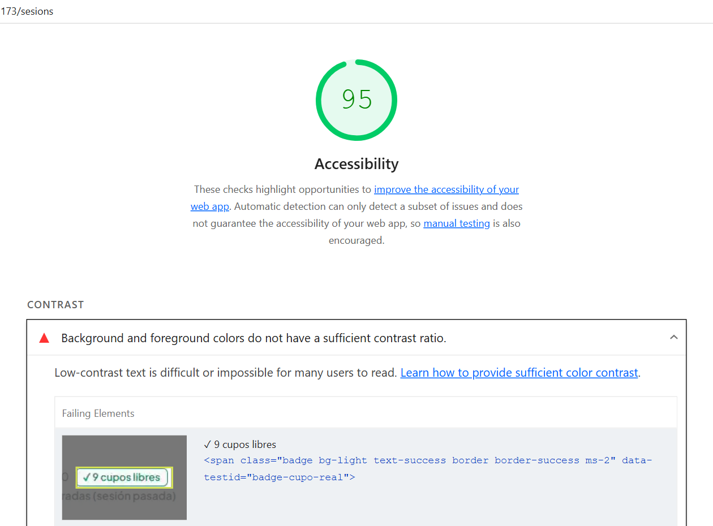 | 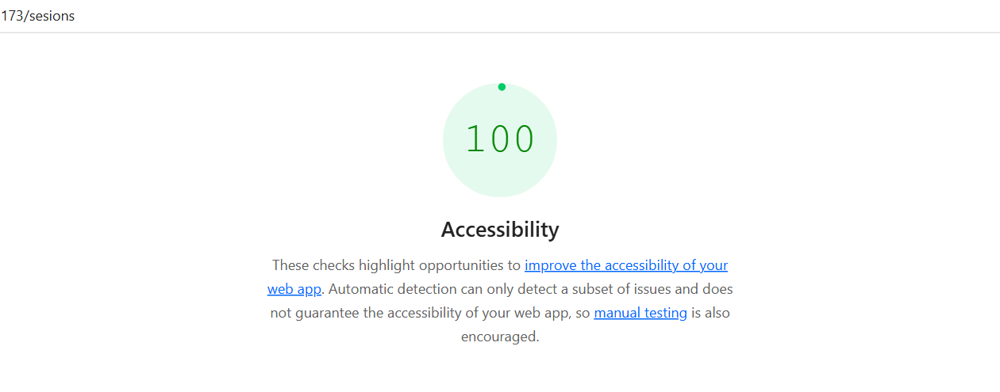 |
| Analítica (`/analitica`) | 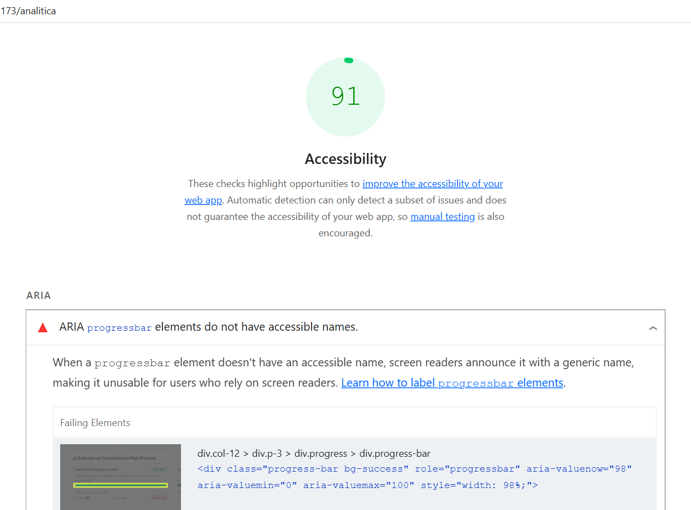 | 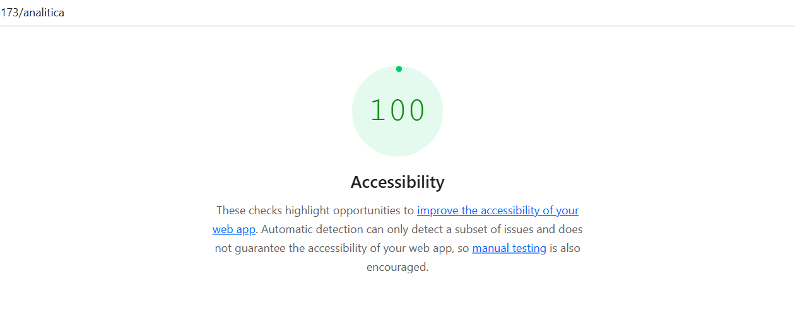 |
| Recuperar contraseña (`/recover`) | 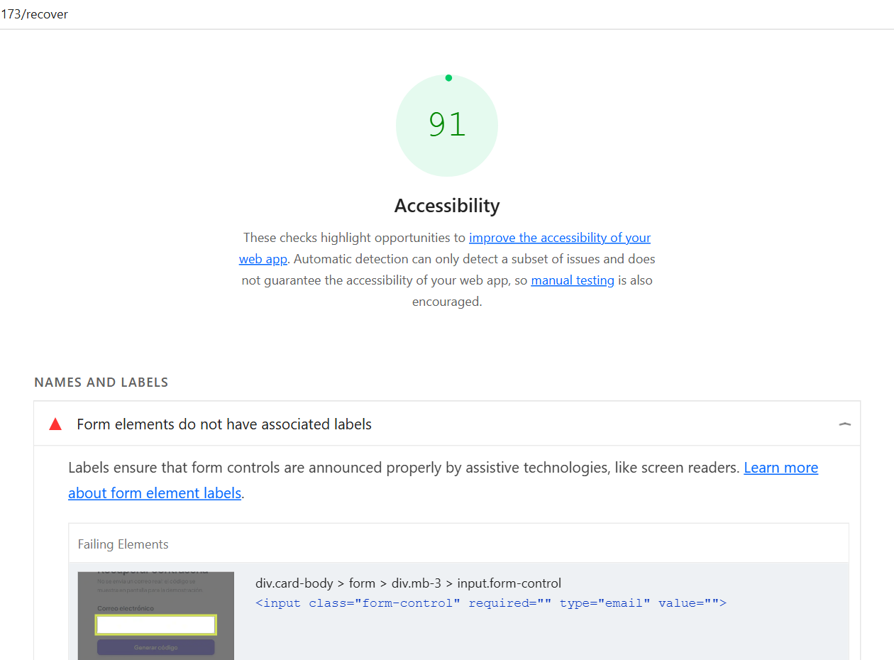 | 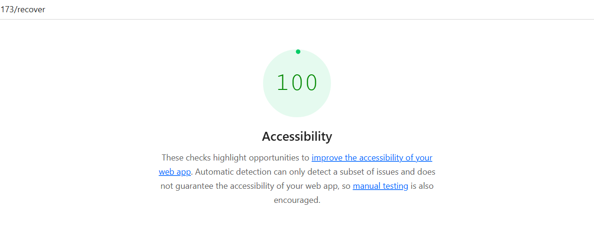 |

### La app

Las dos columnas son la misma pantalla y los mismos datos. El «antes» se cargó con el CSS anterior (versión de git previa a la corrección) y el «después», con el actual.

**Tarjeta de una sesión propia** (`/sesions`). Cambian «📅 Reprogramar sesión», que era celeste con **1.95:1**, «📋 Control de asistencia» y «Estado: Inscripciones abiertas», con verde de **4.29:1**, y el rojo de «🚫 Cancelar sesión». Ahora todos superan **4.5:1**.

| Antes | Después |
| --- | --- |
| 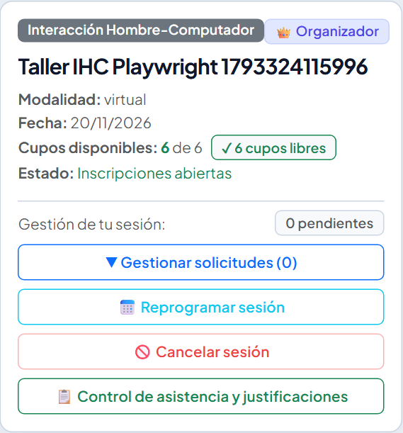 | 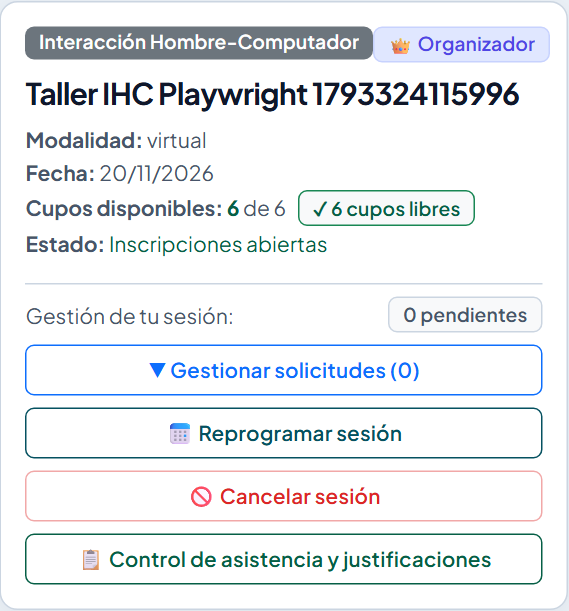 |

**Tarjeta de una solicitud** (`/dashboard?tab=solicitudes`). El cambio es **sutil a la vista, pero cruza el umbral de AA**:
- La materia en gris sobre gris pasa de **3.65:1** a **5.9:1**.
- Las etiquetas «👤 Organizador:» y «📅 Fecha de la sesión:» pasan de **4.44:1** a **7.19:1**.
- El botón rojo «Abandonar sesión» pasa de **3.76:1** a **4.83:1**.

Corregir no exigió cambiar la estética: bastó con oscurecer un poco los tokens.

| Antes | Después |
| --- | --- |
| 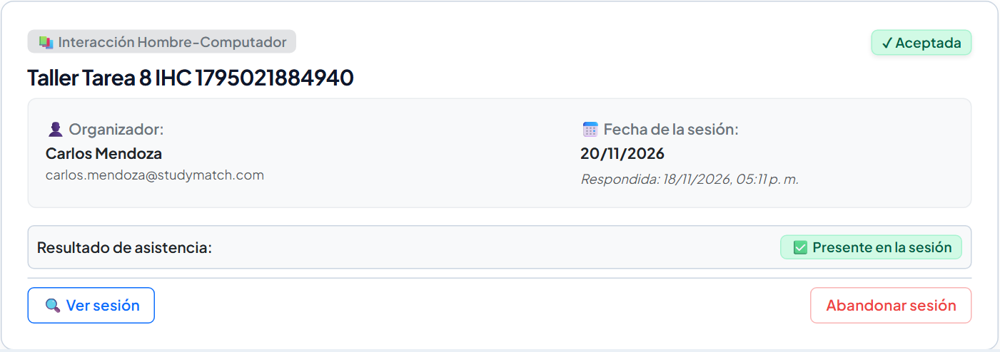 | 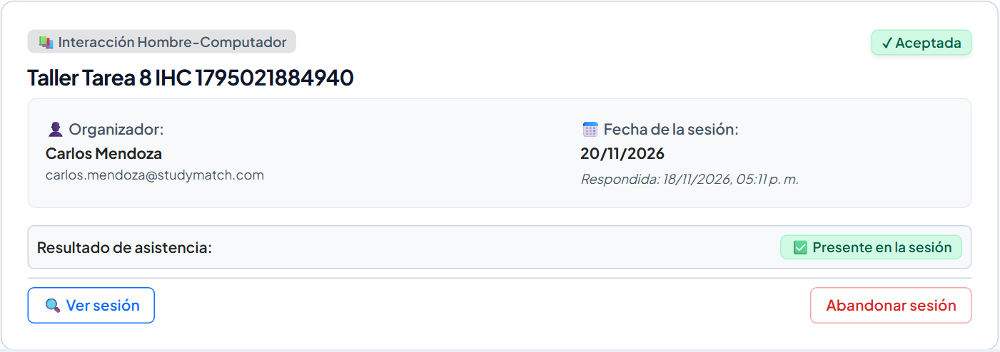 |

**Cabecera de Analítica** (`/analitica`). «(solo desarrollo)» era gris oscuro sobre fondo oscuro (**1.2:1**, casi invisible).

| Antes | Después |
| --- | --- |
| 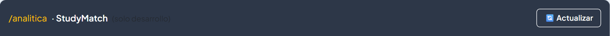 | 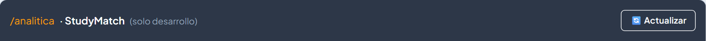 |

---

## Interpretación: qué encontró y por qué importa

### 1. Contraste insuficiente (`color-contrast`) · impacto **serio** · 1586 elementos

**Qué es:** WCAG 2.1 (criterio 1.4.3) exige que el texto normal tenga un contraste de al menos **4.5:1** con su fondo. Por debajo, el texto se lee mal con poca luz o con el brillo bajo, en pantallas de mala calidad, y lo leen peor las personas con baja visión o con daltonismo.

**Por qué pasaba:** los colores no venían de nuestro diseño, sino de las **clases por defecto de Bootstrap**, que están pensadas para fondo blanco. En la app se usan sobre fondos claros (`#f8f9fa`, `#e2e3e5`, `#fef2f2`), y ahí no llegan al mínimo:

| Color (clase de Bootstrap o token anterior) | Sobre | Contraste | Elementos | Dónde |
| --- | --- | :---: | :---: | --- |
| `#6c757d` (`.text-secondary`, `.text-muted`) | `#f8f9fa` | 4.44:1 ❌ | 662 | Datos de las tarjetas: «👤 Organizador:», «📅 Fecha…» |
| `#6c757d` | `#e2e3e5` (badge de materia) | 3.65:1 ❌ | 192 | «📚 Cálculo II» en solicitudes e historial |
| `#198754` (`.text-success`) | `#f8f9fa` | 4.29:1 ❌ | 178 | «✓ 3 cupos libres» |
| `#ef4444` (token `color-error`) | blanco | 3.76:1 ❌ | 158 | Botones «Cerrar sesión», «Abandonar sesión», «✕ Rechazar» |
| `#dc3545` (`.text-danger`) | `#f8d7da` / `#f8f9fa` | 3.39 / 4.29:1 ❌ | 296 | Motivo de una sesión cancelada |
| `#0dcaf0` (`.text-info`, `.btn-outline-info`) | blanco / `#f8f9fa` | 1.95 / 1.85:1 ❌ | 70 | «📅 Reprogramar sesión», «Reprogramada: …» |
| `#d63384` (`code`) | `#fff3cd` | 4.06:1 ❌ | 4 | Nombres de eventos en la alerta de Analítica |
| `#6c757d` sobre la cabecera oscura | `#2d3748` | 1.2:1 ❌ | 2 | «(solo desarrollo)» en Analítica |

**Cómo se corrigió**, en la raíz y no elemento por elemento:
1. **Tokens.** Se ajustaron dos tokens en Figma y en [`tokens.css`](../frontend/src/tokens.css), así todo lo que los usa se corrige a la vez:
   - `color-texto-secundario`: `#64748b` → **`#475569`**
   - `color-error`: `#ef4444` → **`#dc2626`**
2. **Clases de Bootstrap.** En [`index.css` § 8](../frontend/src/index.css) se conectaron a tokens que sí cumplen AA:
   - `.text-secondary` y `.text-muted` → `color-texto-secundario`
   - `.text-success` → `color-exito-texto`
   - `.text-danger` → `color-error-texto`
   - `.text-warning` → `color-advertencia-texto`
   - `.text-info` → `color-info-texto`
   - `.btn-outline-info`, `.btn-outline-warning` y `.btn-outline-success` → sus tokens `-texto`
3. **Casos puntuales** en [`AnaliticaPage.jsx`](../frontend/src/AnaliticaPage.jsx): sobre la cabecera oscura, el texto usa `color-nav-texto` y la ruta `/analitica` usa `color-advertencia`, que es claro y contrasta bien sobre oscuro.

### 2. Campo de formulario sin etiqueta (`label`) · impacto **crítico** · 2 elementos

**Qué es:** el campo «Correo electrónico» de *Recuperar contraseña* mostraba su `<label>` en pantalla, pero no estaba **asociado** al `<input>` (WCAG 1.3.1 y 4.1.2). Un lector de pantalla anunciaba «campo de texto» sin decir qué pedía, y al tocar la etiqueta no se enfocaba el campo.

**Causa:** el componente `Input` usaba el `name` como `id`, y en Recuperar contraseña el campo no tiene `name`.

**Corrección:** [`Components.jsx`](../frontend/src/Components.jsx) genera un `id` único con `useId()` cuando no llega ni `id` ni `name`. Así queda resuelto para **cualquier** formulario futuro, no solo para este.

### 3. Barras de progreso sin nombre (`aria-progressbar-name`) · impacto **serio** · 16 elementos

**Qué es:** las barras verde y roja de los embudos de `/analitica` tenían `role="progressbar"`, pero ningún nombre. Un lector de pantalla decía «barra de progreso, 82 %» sin indicar de qué flujo ni si era éxito o caída.

**Corrección:** cada barra tiene ahora un `aria-label`, por ejemplo «Solicitud de ingreso a sesión: 82.2 % de éxito».

### 4. Regiones con desplazamiento sin acceso por teclado (`scrollable-region-focusable`) · impacto **serio** · 6 elementos

**Qué es:** la lista de «Últimos eventos» de Analítica y las dos tablas de *Mis datos* tienen altura máxima y barra de desplazamiento. Quien navega **solo con teclado** no podía llegar a ellas para desplazarse.

**Corrección:** `tabIndex={0}`, `role="region"` y `aria-label` descriptivo, así se pueden enfocar con Tab y desplazar con las flechas.

---

## Contraste AA comprobado (tokens del sistema de diseño)

Contraste de los tokens de texto sobre los fondos donde se usan, calculado con la fórmula de WCAG. **Mínimo AA: 4.5:1.**

| Token de texto | Blanco | `#f8f9fa` | `#eaf0f6` (fondo) | `#e2e3e5` | Fondo de su estado |
| --- | :---: | :---: | :---: | :---: | :---: |
| `color-texto` `#0f172a` | 17.85 ✅ | 16.94 ✅ | 15.55 ✅ | 13.90 ✅ | — |
| `color-texto-secundario` `#475569` | 7.58 ✅ | 7.19 ✅ | 6.60 ✅ | 5.90 ✅ | — |
| `color-accion` `#4f46e5` | 6.29 ✅ | 5.96 ✅ | 5.48 ✅ | 4.90 ✅ | — |
| `color-error` `#dc2626` (texto de botón Peligro) | 4.83 ✅ | 4.58 ✅ | — | — | — |
| `color-exito-texto` `#065f46` | 7.68 ✅ | 7.29 ✅ | — | — | 6.78 ✅ |
| `color-advertencia-texto` `#92400e` | 7.09 ✅ | 6.73 ✅ | — | — | 6.37 ✅ |
| `color-error-texto` `#991b1b` | 8.31 ✅ | 7.88 ✅ | — | — | 6.80 ✅ |
| `color-info-texto` `#055160` | 8.93 ✅ | 8.47 ✅ | — | — | 7.65 ✅ |

Texto blanco (`color-texto-sobre-color`) sobre los fondos de color:
- Botón Primario (`color-accion`): **6.29:1** ✅
- Primario en hover (`color-accion-hover`): **7.90:1** ✅
- Peligro en hover (`color-error`): **4.83:1** ✅

En el **modo oscuro** de Figma también se verificó el botón Primario: texto blanco sobre `#5b54eb`, **5.37:1** ✅. Se descartó `#818cf8` porque daba 2.9:1.

---

## Cómo se mantiene

- **Prueba automática:** [`tests/accesibilidad_wcag_aa.spec.ts`](../tests/accesibilidad_wcag_aa.spec.ts) audita las 11 pantallas en escritorio y móvil con axe (WCAG 2.1 AA). Si alguien introduce un color sin contraste o un campo sin etiqueta, la prueba falla y dice la regla, la pantalla y el elemento.
- **Un solo lugar para los colores:** como todo sale de `tokens.css`, un ajuste de contraste se hace una vez y se aplica en toda la app, como pasó con `color-texto-secundario`.

## Límites de la revisión automática

Lighthouse y axe detectan alrededor de un tercio de los problemas de accesibilidad posibles. Estas comprobaciones **no las cubren** y quedan como revisión manual:
- Orden lógico del foco al navegar con Tab en los modales.
- Que los mensajes de error se anuncien al lector de pantalla en el momento en que aparecen.
- Que los emojis decorativos de los botones (📨, 👑…) no se lean de más. Hoy un lector los anuncia junto al texto del botón.
