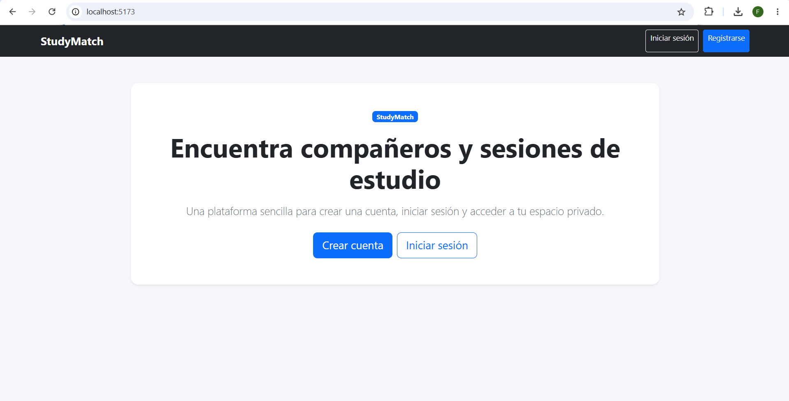
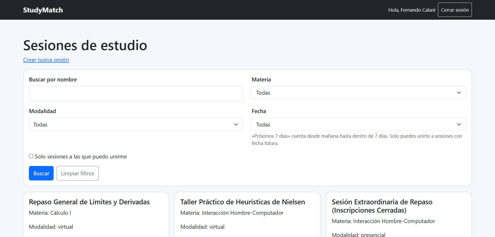
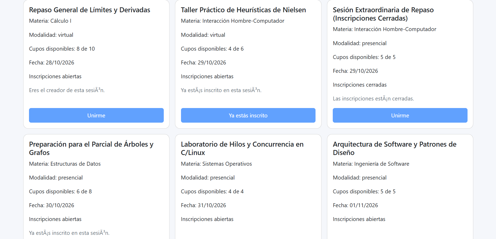

# Evidencias Clase 17 - Análisis de Proyecto Recibido

**Materia:** Interacción Hombre-Computador (IHC)  
**Estudiante:** Fernando Calani  
**Entregable:** Reto Práctico - Clase 17: Código Ajeno y Refactoring  

---

## 1. Proyecto recibido

- **Autor / Grupo anterior:** Brayan Gonzales (BrayanG123)
- **Enlace al repositorio recibido:** [https://github.com/BrayanG123/proyecto_2_IHC](https://github.com/BrayanG123/proyecto_2_IHC)
- **Tecnologías identificadas:**
  - **Frontend:** React (Vite), React Router DOM, Bootstrap 5.
  - **Backend:** FastAPI, Uvicorn, SQLAlchemy, JWT (python-jose), encriptación de contraseñas con crypt.
  - **Base de Datos:** Arquitectura relacional persistente conectada mediante SQLAlchemy con soporte para PostgreSQL 16 y SQLite.
  - **Despliegue y Contenerización:** Docker y Docker Compose con red bridge dedicada (studymatch_fork_net).

---

## 2. Ejecución

### Comandos utilizados para el despliegue

El proyecto se configuró y desplegó en su totalidad mediante **Docker Compose**, orquestando tres servicios aislados (Base de Datos, Backend y Frontend):

`ash
# 1. Posicionarse en la carpeta raíz del proyecto recibido
cd "D:\INTERACCION HOMBRE-COMPUTADOR\Segundo Proyecto Fork"

# 2. Levantar los tres contenedores con construcción de imágenes
docker compose up --build -d
`

*Adicionalmente, se configuraron scripts para ejecución local nativa:*
- **Backend:** uvicorn main:app --host 0.0.0.0 --port 8000
- **Frontend:** 
pm run dev -- --host 0.0.0.0 --port 5173

### Puertos y Servicios Activos
- **Frontend Web:** http://localhost:5173
- **Backend API & Swagger Docs:** http://localhost:8000/docs
- **Base de Datos Externa (PostgreSQL):** Puerto 5434:5432 con volumen persistente en ./database/pgdata.

### Captura de Ejecución Funcional

La aplicación web carga y responde correctamente desde el contenedor Docker, permitiendo el acceso público y la navegación hacia el registro e inicio de sesión:

---

## 3. Recorrido: Pantalla → Acción → Regla → Datos

Se realizó el rastreo de extremo a extremo del flujo de interacción principal del sistema: **Inscripción a una sesión de estudio existente**.

`
┌─────────────────────────┐       ┌────────────────────────┐
│  PANTALLA (Frontend)    │ ────> │  ACCIÓN (Frontend JS)  │
│  SesionsPage.jsx        │       │  unirse(sesionId)      │
└─────────────────────────┘       └────────────────────────┘
                                               │
                                               ▼
┌─────────────────────────┐       ┌────────────────────────┐
│  DATOS (BD / Modelo)    │ <──── │  REGLA (Backend)       │
│  Tabla inscriprciones   │       │  motivo_para_unirse()  │
└─────────────────────────┘       └────────────────────────┘
`

### 1. Pantalla (Interfaz de Usuario)
- **Archivo:** rontend/src/SesionsPage.jsx
- **Elementos visuales:**
  - Barra de búsqueda y filtros combinados (nombre, materia, modalidad, fecha y disponibilidad).
  - Listado de tarjetas de sesiones (
) con detalle de cupos, modalidad, materia y fecha.
  - Botón de interacción dinámico:
    `jsx
    <button 
      className="btn btn-primary mt-auto" 
      disabled={!sesion.puede_unirse || inscribiendo !== null}
      onClick={() => unirse(sesion.id)}
    >
      {inscribiendo === sesion.id ? "Inscribiendo..." : sesion.inscrito ? "Ya estás inscrito" : "Unirme"}
    </button>
    `

### 2. Acción (Manejador de Evento y Comunicación API)
- **Archivo:** rontend/src/SesionsPage.jsx (líneas 103–118) y rontend/src/api.js
- **Código real:**
  `javascript
  async function unirse(sesionId) {
    setInscribiendo(sesionId);
    setErrorInscripcion("");
    setMensaje("");
    try {
      const respuesta = await apiRequest(/sesiones//inscribirse, { method: "POST" });
      setMensaje(respuesta.mensaje);
    } catch (err) {
      setErrorInscripcion(err.message);
    } finally {
      setInscribiendo(null);
      setActualizacion((valor) => valor + 1);
    }
  }
  `
  La función toma el sesionId, bloquea temporalmente el botón para prevenir doble clic, envía la petición POST /sesiones/{sesion_id}/inscribirse con el token JWT de autenticación (Authorization: Bearer <token>) y actualiza el estado visual tras la respuesta.

### 3. Regla (Controlador de Rutas y Lógica de Negocio)
- **Archivos:** ackend/app/routes.py (líneas 124–139) y ackend/app/repositorio.py (líneas 53–99)
- **Endpoint HTTP:**
  `python
  @router.post("/sesiones/{sesion_id}/inscribirse")
  def inscribirse(sesion_id: int, usuario = Depends(obtener_usuario_actual), db: Session = Depends(get_db)):
      try:
          unirse_a_sesion(db, sesion_id, usuario.id)
          return {"mensaje": "Inscripción confirmada."}
      except ValueError as err:
          raise HTTPException(status_code=400, detail=str(err))
  `
- **Lógica de validación de negocio (motivo_para_unirse):**
  La operación evalúa las restricciones de interacción de forma determinista:
  1. **Creador:** No puede inscribirse a su propia sesión (sesion.usuario_id == usuario_id).
  2. **Inscripción previa:** Bloquea duplicados si el usuario ya figura en la tabla de inscripciones (ya_inscrito).
  3. **Estado de inscripción:** Requiere que la sesión esté abierta (sesion.inscripciones_abiertas == True).
  4. **Fecha futura:** Solo permite inscribirse si la fecha es posterior al día de hoy en la zona horaria local (sesion.fecha > fecha_actual()).
  5. **Capacidad / Cupo:** Verifica que la cantidad de inscritos sea menor que la capacidad total (inscritos < sesion.cupo).

### 4. Datos (Persistencia y Modelado)
- **Archivo:** ackend/app/modelos_db.py (líneas 37–50) y esquema en database/
- **Modelo SQLAlchemy:**
  `python
  class Inscripcion(Base):
      __tablename__ = "inscriprciones"

      usuario_id = Column(Integer, ForeignKey("usuarios.id"), primary_key=True)
      sesion_id = Column(Integer, ForeignKey("sesiones.id"), primary_key=True)
      fecha_inscripcion = Column(
          DateTime,
          nullable=True,
          default=fecha_inscripcion_actual,
      )
  `
- **Persistencia:** Al ejecutarse db.commit(), se inserta una fila con la tupla única (usuario_id, sesion_id, fecha_inscripcion) en el motor de base de datos relacional. Los cupos libres se calculan restando las filas existentes al valor sesion.cupo.

---

## 4. Impacto: Qué deberá cambiar para implementar la Tarea 5

### Requisito Asignado para StudyMatch (Lámina 18)
> **"StudyMatch: Solicitar unirse a una sesión; el organizador acepta o rechaza. La funcionalidad debe persistir: el resultado debe mantenerse después de recargar o volver a entrar."**

Actualmente la inscripción es **inmediata y automática** (el alumno pulsa *"Unirme"* y queda inscrito directamente). Para cumplir la **Tarea 5**, la relación estudiante-sesión debe convertirse en un **flujo de solicitud con aprobación asíncrona por parte del organizador**.

A continuación se detalla el análisis de impacto por capas:

### 1. Interfaz (Pantalla)
- **Para el estudiante postulante (rontend/src/SesionsPage.jsx):**
  - El botón cambiará de "Unirme" a "Solicitar unirse".
  - La tarjeta reflejará los 3 estados posibles de la solicitud:
    - Pendiente: Botón deshabilitado con mensaje *"Solicitud enviada (Pendiente de aprobación)"*.
    - Aceptada: Indicador de éxito *"Inscripción confirmada por el organizador"*.
    - Rechazada: Indicador informativo *"Solicitud no aceptada"*.
- **Para el organizador / creador (rontend/src/Dashboard.jsx o panel de sesión):**
  - En las sesiones que el usuario creó, se debe incorporar una sección visible de **"Solicitudes de unión pendientes"**.
  - Lista de solicitantes (nombre del estudiante, fecha de solicitud) junto a dos acciones claras:
    - Botón **"Aceptar"** (verde / prioritario).
    - Botón **"Rechazar"** (secundario / neutral).

### 2. Acciones y Controladores (Frontend / API)
- **Frontend (rontend/src/api.js y componentes):**
  - Función solicitarUnirse(sesionId): Invoca POST /sesiones/{id}/solicitar.
  - Función 
esponderSolicitud(solicitudId, decision): Invoca POST /solicitudes/{id}/aprobar o POST /solicitudes/{id}/rechazar.
- **Backend Endpoints (ackend/app/routes.py):**
  - POST /sesiones/{sesion_id}/solicitar: Registra la solicitud del alumno con estado inicial PENDIENTE.
  - GET /sesiones/{sesion_id}/solicitudes: Retorna las solicitudes pendientes (restringido con 403 Forbidden si quien consulta no es el creador).
  - PUT /solicitudes/{solicitud_id}/responder: Endpoint para que el organizador transmita su decisión (ceptada o 
echazada).

### 3. Lógica y Reglas de Negocio (ackend/app/repositorio.py)
- **Máquina de estados de la solicitud:**
  - $\text{PENDIENTE} \longrightarrow \text{Organizador aprueba} \longrightarrow \text{ACEPTADA}$
  - $\text{PENDIENTE} \longrightarrow \text{Organizador rechaza} \longrightarrow \text{RECHAZADA}$
- **Cálculo de cupos disponibles:**
  Solo las solicitudes con estado ACEPTADA deben descontar del cupo disponible. Las solicitudes PENDIENTE o RECHAZADA no deben consumir plazas definitivas.
- **Autorización estricta:**
  Solo el usuario que coincida con sesion.usuario_id puede cambiar el estado de la solicitud.
- **Unicidad:**
  Un estudiante no puede crear una nueva solicitud si ya cuenta con una solicitud PENDIENTE o ACEPTADA en esa sesión.

### 4. Datos y Esquema de Base de Datos (ackend/app/modelos_db.py y database/)
- Modificar la entidad de persistencia Inscripcion (o renombrar a SolicitudInscripcion) agregando las siguientes columnas:
  - estado: String / VARCHAR(20) con valor por defecto 'pendiente' (posibles valores: 'pendiente', 'aceptada', 'rechazada').
  - echa_solicitud: DateTime (marca temporal de envío).
  - echa_respuesta: DateTime (nullable, marca temporal de resolución por el organizador).
- La información persistirá directamente en la base de datos de Docker (studymatch_fork_db), garantizando que al recargar la página o cerrar sesión el estado se conserve íntegro.

### 5. Red de Seguridad (Pruebas Automatizadas)
- Crear ackend/tests/test_solicitudes.py antes de codificar la nueva funcionalidad:
  - 	est_crear_solicitud_queda_en_estado_pendiente()
  - 	est_organizador_puede_aceptar_solicitud_y_descuenta_cupo()
  - 	est_organizador_puede_rechazar_solicitud_y_no_descuenta_cupo()
  - 	est_usuario_no_organizador_no_puede_aprobar_ni_rechazar() (403 Forbidden).
  - 	est_no_permite_solicitud_duplicada()

---

**Conclusión:** El proyecto recibido se encuentra completamente funcional, documentado y preparado estructuralmente para ejecutar la refactorización e implementación de la Tarea 5.
