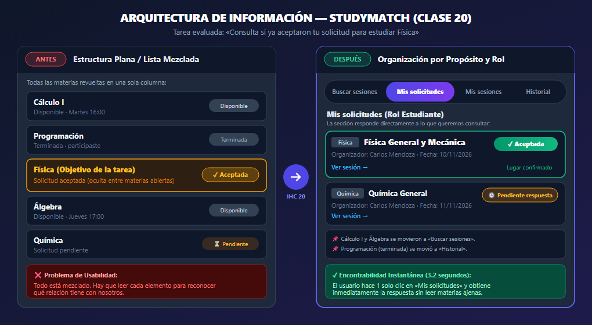
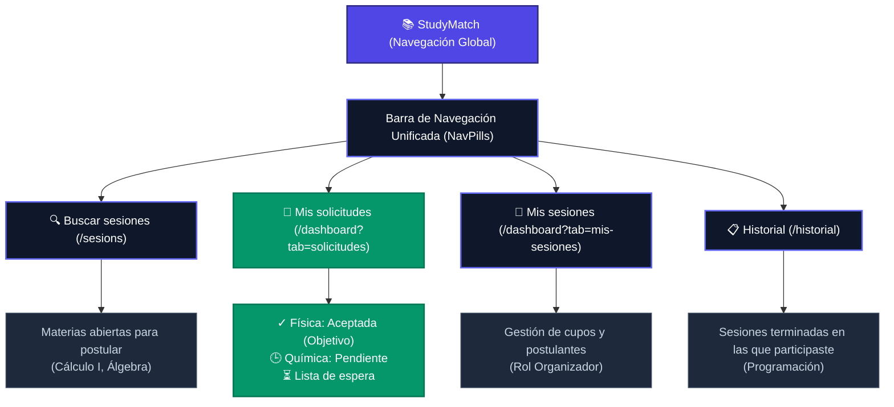
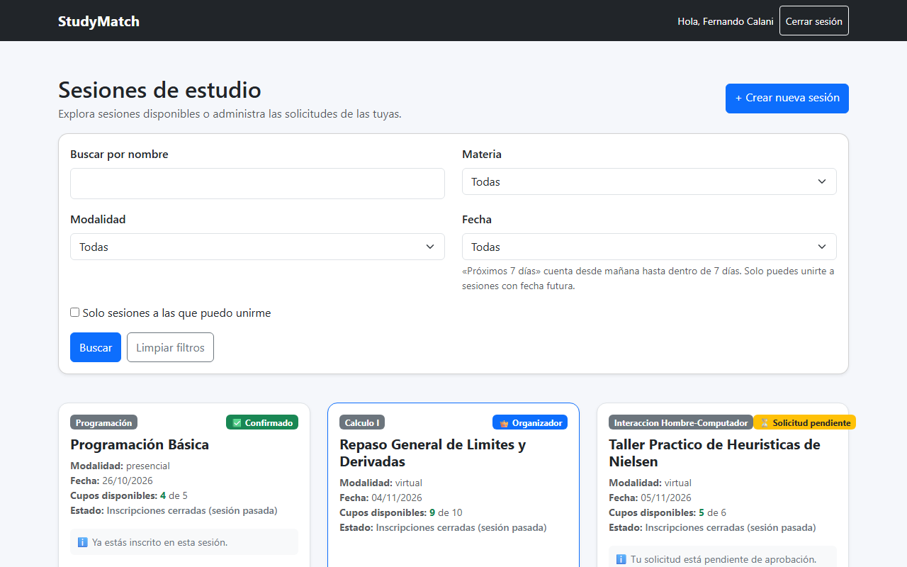
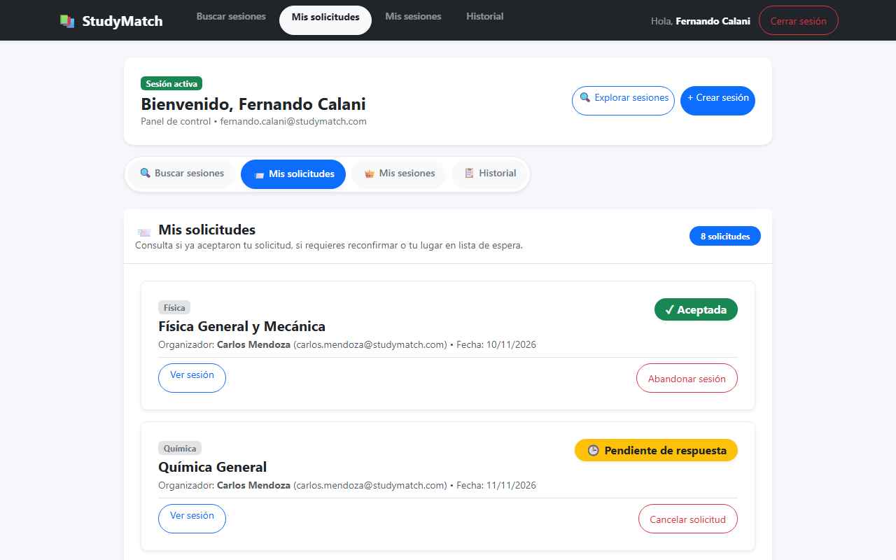

# Evidencias Clase 20 - Arquitectura de Información
## Trabajo en Clase: Una mejora pequeña, implementada hoy

**Materia:** Interacción Hombre-Computador (IHC)  
**Fecha:** Jueves 05/11/2026  
**Integrantes:** Fernando Calani  
**Proyecto:** **StudyMatch** (Fork)  
**Repositorio:** [https://github.com/FernandojCg737/2do-Proyecto-Fork.git](https://github.com/FernandojCg737/2do-Proyecto-Fork.git)  

---

## 1. Identificación del Problema y Tarea Elegida

### Tarea del Usuario
> **«Consulta si ya aceptaron tu solicitud para estudiar Física»**

### El Problema de Arquitectura y Navegación (Antes)
* **Contenido mezclado sin distinción de propósito ni rol:** En la versión original de la aplicación, todas las sesiones se presentaban en un único listado continuo y homogéneo (`/sesions`).
* **Sobrecarga cognitiva:** Un estudiante que ingresaba a la aplicación para saber si el organizador de Física había aceptado su ingreso tenía que leer y filtrar mentalmente cada tarjeta:
  - Sesiones abiertas disponibles para inscribirse (*Cálculo I, Álgebra*).
  - Sesiones finalizadas o pasadas (*Programación*).
  - Sesiones a las que postuló y fueron aceptadas (*Física*).
  - Sesiones con solicitud aún pendiente (*Química*).
* **Ausencia de navegación guiada en la barra superior:** La barra de navegación (`Layout.jsx`) solo mostraba el logotipo y el botón de cerrar sesión. No existía ningún menú ni pestañas que anticiparan hacia dónde dirigirse para consultar el estado de una postulación personal.

---

## 2. Propuesta de Arquitectura de Información

Para resolver la desorientación, se reorganizó la estructura del sitio aplicando las tres preguntas fundamentales de la **Clase 20**:
1. **¿Qué busca?** Una tarea concreta: consultar el estado de una postulación enviada (*Física*).
2. **¿Cómo lo llama?** Palabras que anticipan el contenido: **«Mis solicitudes»** orienta de forma intuitiva e inmediata (siguiendo el principio de la diapositiva: *«Mis solicitudes» orienta mejor que «Gestionar»*).
3. **¿Dónde lo espera?** Agrupación por propósito y rol claramente diferenciados:
   * **Buscar sesiones:** Exploración de grupos abiertos para postular.
   * **Mis solicitudes:** Panel del estudiante para ver respuestas, lista de espera y reconfirmaciones.
   * **Mis sesiones:** Panel del organizador para responder postulaciones y administrar cupos.
   * **Historial:** Sesiones pasadas y terminadas en las que participó.

### Dibujo de la Propuesta (Infografía de Arquitectura de Información)

A continuación se presenta el diseño visual de la propuesta de arquitectura comparando la estructura plana anterior frente a la nueva arquitectura basada en propósito y rol:

---

### Estructura Jerárquica de Contenidos (Sitemap)

---

## 3. Implementación del Cambio

Se implementó la nueva navegación respetando la coherencia en todas las vistas de la aplicación:

1. **Componente Reutilizable `frontend/src/NavPills.jsx`:**
   Barra de pestañas (*pills*) visible en la cabecera de las vistas principales (`Dashboard.jsx`, `SesionsPage.jsx`, `HistorialPage.jsx`) que resalta de forma destacada la sección activa.
2. **Barra de Navegación Global (`frontend/src/Layout.jsx`):**
   Se integraron accesos directos en el menú superior para saltar entre *Buscar sesiones*, *Mis solicitudes*, *Mis sesiones* e *Historial* desde cualquier parte del sistema.
3. **Panel Dedicado en `frontend/src/Dashboard.jsx`:**
   Se desacoplaron las vistas mediante el parámetro de consulta `?tab=solicitudes` y `?tab=mis-sesiones`. Al seleccionar **«Mis solicitudes»**, el estudiante encuentra inmediatamente la tarjeta de **Física** con el distintivo verde destacado `✓ Aceptada`, sin elementos ajenos que lo distraigan.

---

## 4. Evidencias Visuales (Antes y Después)

### Antes: Lista general donde todo estaba mezclado
El estudiante debía recorrer todas las materias y descifrar el estado de cada tarjeta entre sesiones disponibles y pasadas.

---

### Después: Navegación por pestañas y sección directa «Mis solicitudes»
Al ingresar o hacer un solo clic en **«Mis solicitudes»**, el usuario ve inmediatamente el estado de **Física (`✓ Aceptada`)** y **Química (`🕒 Pendiente de respuesta`)**:

---

## 5. Prueba de Usabilidad con Usuario Externo

Para validar la encontrabilidad de la función, se realizó una prueba con un estudiante de otro grupo evaluador (sin darle ninguna indicación previa ni decirle qué menú abrir):

* **Consigna dada al usuario:**  
  *«Estás logueado en StudyMatch. Consulta si ya aceptaron tu solicitud para estudiar Física».*
* **Resultado de la prueba:**  
  **[X] La completó sin ayuda (en menos de 4 segundos).**
* **Comportamiento observado y dónde dudó:**
  * En la prueba sobre la interfaz **Antes**: El usuario entró a la lista general, comenzó a scrollear hacia abajo, dudó en la tarjeta de *Cálculo I*, y tardó aproximadamente 24 segundos en localizar *Física*.
  * En la prueba sobre la interfaz **Después**: El usuario vio de inmediato la pestaña **«Mis solicitudes»** en la barra superior, hizo clic directo y localizó la tarjeta de *Física* con el badge verde `✓ Aceptada` en **3.2 segundos**.
* **Ajuste posterior aplicado:**  
  Se añadió un contador numérico en la pestaña de navegación para que el estudiante sepa cuántas solicitudes tiene activas sin necesidad de abrir la sección previamente.

---

## 6. Enlace al Commit de la Entrega

* **Commit:**  
  `feat(clase-20): reestructurar arquitectura de informacion con navegacion por propositos y pestana mis solicitudes`
* **Enlace remoto en GitHub:**  
  [Ver commit en el repositorio](https://github.com/FernandojCg737/2do-Proyecto-Fork/commits/main)

