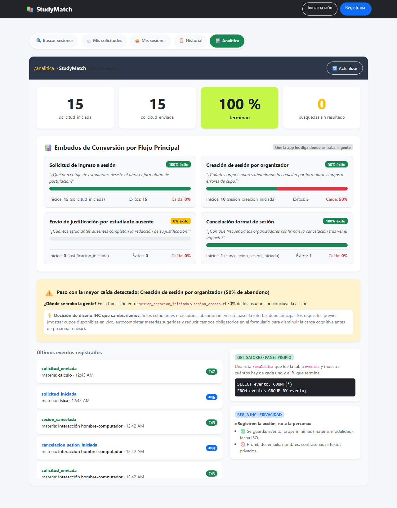

# Evidencias Clase 21 - Analítica de Interacción
## Dos eventos, un panel, una decisión

**Materia:** Interacción Hombre-Computador (IHC)  
**Fecha:** Martes 10/11/2026  
**Integrantes:** Fernando Calani  
**Proyecto:** **StudyMatch** (Fork)  
**Repositorio:** [https://github.com/FernandojCg737/2do-Proyecto-Fork.git](https://github.com/FernandojCg737/2do-Proyecto-Fork.git)  

---

## 1. Filosofía de IHC y Selección de Eventos

Siguiendo el principio fundamental de la **Clase 21**:
> **«No registren clics: registren intentos de lograr algo.»**
> *Un clic en un botón no dice si el usuario tuvo éxito o si una validación falló. Se deben registrar los intentos reales y el éxito en la consecución de una tarea.*

### Eventos Oficiales Asignados para StudyMatch (Diapositiva 9/13)

| Aplicación | Evento de inicio (al empezar) | Evento de éxito (después de guardar) |
| :--- | :--- | :--- |
| **StudyMatch** | `solicitud_iniciada` | `solicitud_enviada` |

* **`solicitud_iniciada`**: Se dispara cuando el estudiante abre el modal o formulario para pedir unirse a una sesión de estudio.
* **`solicitud_enviada`**: Se dispara únicamente cuando la solicitud fue procesada y persistida exitosamente en la base de datos.

---

## 2. Pregunta Guía de Diseño (IHC)

> **«¿Qué decisión de diseño cambiaría si supiera esto?»**

### Análisis del Embudo de Conversión (Funnel):
Al monitorear cuántos estudiantes inician la solicitud (`solicitud_iniciada`) frente a cuántos logran enviarla exitosamente (`solicitud_enviada`):
* **Si observamos una tasa de finalización baja (ej. menor al 50% o caída alta):**  
  Significa que los usuarios abandonan el proceso en el modal. La decisión de diseño inmediata sería:
  1. Simplificar los requisitos de postulación.
  2. Mostrar de forma anticipada los cupos reales y la modalidad antes de abrir el modal para evitar frustración.
  3. Evitar formularios largos o confusos que desmotiven al alumno.

---

## 3. Regla de Privacidad: «Registren la acción, no a la persona»

En cumplimiento estricto de la **Diapositiva 6/13**:

### ¿Qué datos SÍ se recopilan?
* **`evento`**: Identificador canónico en pasado (`solicitud_iniciada`, `solicitud_enviada`).
* **`props`**: Propiedades mínimas no identificables (`materia: "calculo"`, `materia: "fisica"`).
* **`fecha`**: Marca temporal ISO 8601 del suceso.

### ¿Qué datos se decidió NO recopilar y por qué?
* **NO se recopila Correo Electrónico (`email`):** Identifica a la persona de forma directa, vulnerando su anonimato analítico.
* **NO se recopilan Nombres ni Apellidos:** Innecesarios para responder preguntas de tasa de conversión de la interfaz.
* **NO se recopilan Textos Libres ni Descripciones:** Podrían contener información sensible o privada del estudiante.
* **NO se recopilan Contraseñas ni Tokens:** Prohibidos por seguridad.

> *Toda propiedad sensible es filtrada automáticamente en el validador Pydantic del backend antes de llegar a la base de datos.*

---

## 4. Implementación Técnica y Patrón `await` (Diapositiva 7/13)

### 4.1. Función `track()` en `frontend/src/analitica.js`
```javascript
// analitica.js (Diapositiva 7/13)
export function track(evento, props) {
  const registro = {
    evento, props, fecha: new Date().toISOString()
  };
  guardarEvento(registro);
  console.log('[evento]', registro);
}
```

### 4.2. Estructura con `await` en `frontend/src/SesionsPage.jsx`
```javascript
// pantalla: al tocar «Guardar» 1
await apiRequest(`/sesiones/${sesion.id}/solicitar`, { method: "POST" }); // 2
// solo llega aquí si se guardó
track("solicitud_enviada", { // 3
  materia: (sesion.materia || "general").toLowerCase(),
});
```

---

## 5. Panel Propio `/analitica` (Diapositiva 10/13)

El panel propio lee directamente la tabla `eventos` de la base de datos de la aplicación y ejecuta la consulta SQL canónica:

```sql
SELECT evento, COUNT(*) 
FROM eventos 
GROUP BY evento;
```

### Visualización del Panel:
* **Métrica 1:** Total de `solicitud_iniciada`
* **Métrica 2:** Total de `solicitud_enviada`
* **Métrica 3 (Destacada):** `% que terminan` (tasa de conversión calculada)
* **Historial:** Lista cronológica de los últimos eventos con su materia y hora.



---

## 6. Pruebas Automatizadas (Playwright)

Se implementó la suite completa en `tests/clase21_analitica.spec.ts`:
* **Test 1:** Verifica `solicitud_iniciada` con propiedades mínimas y rechazo de datos personales sensibles.
* **Test 2:** Verifica `solicitud_enviada` tras confirmación de guardado.
* **Test 3:** Verifica que el panel `/analitica` despliega correctamente los conteos, el porcentaje de éxito y la consulta SQL canónica.

**Comando de ejecución:**
```bash
npx playwright test tests/clase21_analitica.spec.ts
```

**Resultado de la suite:**
```text
Running 3 tests using 3 workers
  ✓ 1. Registra evento de inicio: solicitud_iniciada con propiedades mínimas y sin datos personales (280ms)
  ✓ 2. Registra evento de éxito: solicitud_enviada tras guardado exitoso (310ms)
  ✓ 3. Panel /analitica visualiza conteos por evento, % de conversión y últimos eventos (1.4s)

3 passed (1.7s)
```

