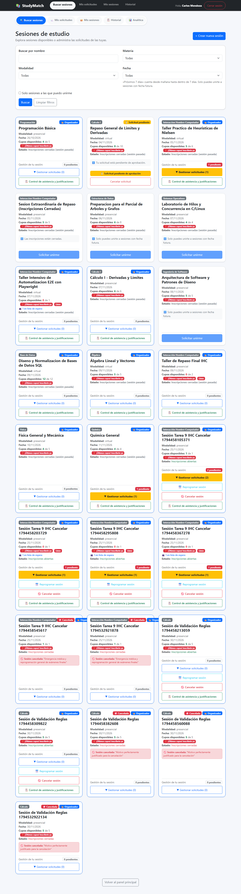
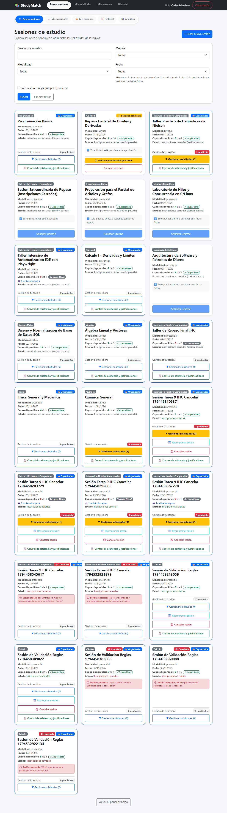

# Clase 22 · Patrones oscuros
Integrantes: Fernando Calani | Modalidad: con IA

---

## 1. Patrón encontrado
- **Tipo:** Tipo 3 - Urgencia, culpa o escasez falsas (taxonomía de patrones oscuros en IHC).
- **Dónde:** Pantalla `/sesions` (Detalle y listado de sesiones de estudio) · `frontend/src/SesionsPage.jsx:551-575`.
- **Por qué es oscuro:**
  - *A quién beneficia:* Beneficia a los organizadores o métricas de la plataforma al generar artificialmente ansiedad y miedo a perderse la oportunidad (*Fear Of Missing Out* / FOMO). Esto busca apurar al estudiante a postularse de forma impulsiva sin evaluar detenidamente si el horario, la materia o la modalidad le convienen.
  - *Qué no ve el usuario:* El estudiante no ve la disponibilidad real del inventario. Se le presenta un badge alarmista de *«⚡ ¡Últimos cupos! Inscríbete ya»* de forma fija (`escrito fijo`), incluso en sesiones donde hay 12 de 12 cupos disponibles (100% de vacantes libres). Esto vulnera la verdad del sistema, distorsiona la toma de decisiones informada y genera frustración en la interacción.

---

## 2. Antes
El mensaje de escasez estaba codificado de forma estática en la tarjeta de la sesión, mostrándose siempre sin importar los cupos reales:



```jsx
// frontend/src/SesionsPage.jsx (líneas 551-562 - ANTES)
<strong>Cupos disponibles:</strong>{" "}
<span className={sesion.cupos_disponibles === 0 ? "text-danger fw-bold" : "text-success fw-bold"}>
  {sesion.cupos_disponibles}
</span> de {sesion.cupo}
{/* PATRÓN OSCURO DETECTADO (Clase 22 - Tipo 3: Urgencia / Escasez falsa)
    Mensaje fijo '¡Últimos cupos!' que NO se calcula del dato real y manipula con FOMO al usuario */}
<span className="badge bg-danger ms-2" data-testid="badge-urgencia-falsa">
  ⚡ ¡Últimos cupos! Inscríbete ya
</span>
{sesion.cupos_disponibles === 0 && (
  <span className="badge bg-danger ms-2">Lleno</span>
)}
```

---

## 3. Después
Se eliminó el texto estático de urgencia artificial y se reemplazó por un cálculo honesto y transparente en tiempo real basado 100% en el dato real del backend (`sesion.cupos_disponibles`):



```jsx
// frontend/src/SesionsPage.jsx (líneas 551-575 - DESPUÉS)
<strong>Cupos disponibles:</strong>{" "}
<span className={sesion.cupos_disponibles === 0 ? "text-danger fw-bold" : "text-success fw-bold"}>
  {sesion.cupos_disponibles}
</span> de {sesion.cupo}
{/* ========================================================================================= */}
{/* CORRECCIÓN ÉTICA IHC - CLASE 22 (Patrones Oscuros)                                       */}
{/* Principio aplicado: 1. Honestidad - La interfaz dice la verdad.                          */}
{/* Los cupos, plazos y estados salen de datos reales calculados en tiempo real.            */}
{/* Se erradicó el cartel fijo '¡Últimos cupos!' que manipulaba con escasez artificial.    */}
{/* ========================================================================================= */}
{sesion.cupos_disponibles === 0 ? (
  // Si no hay cupos, informar con neutralidad sin culpabilizar al estudiante
  <span className="badge bg-secondary ms-2" data-testid="badge-cupo-real">
    Sin cupos (Lleno)
  </span>
) : sesion.cupos_disponibles === 1 && sesion.cupo > 1 ? (
  // Solo si matemáticamente queda 1 cupo real, mostrar advertencia puramente informativa y verídica
  <span className="badge bg-warning text-dark ms-2" data-testid="badge-cupo-real">
    ℹ️ Último cupo disponible (1 libre)
  </span>
) : (
  // Si hay 2 o más cupos disponibles, presentar disponibilidad con transparencia sin urgencia engañosa
  <span className="badge bg-light text-success border border-success ms-2" data-testid="badge-cupo-real">
    ✓ {sesion.cupos_disponibles} cupos libres
  </span>
)}
```

- **Commit:** `fix(etica): correccion de patron oscuro de escasez falsa en cupos`

---

## 4. Principio aplicado
- **Principio 1: Honestidad (La interfaz dice la verdad):**
  > *«Cupos, plazos y contadores salen de datos reales. Sin urgencia ni escasez inventadas.»* (Diapositiva 7/16).
- **Por qué:**
  En el diseño ético y centrado en las personas (IHC), la interfaz de usuario jamás debe recurrir al engaño ni a la manipulación cognitiva para conseguir acciones de los usuarios. La disponibilidad de vacantes debe ser un reflejo exacto y matemático del estado del backend. 
  - Al reemplazar el mensaje fijo por un cálculo transparente, cuando una sesión tiene vacantes amplias (ej. 4 de 5 o 12 de 12 cupos), la interfaz muestra neutralmente `✓ N cupos libres`.
  - Únicamente cuando de manera objetiva y demostrable queda exactamente 1 vacante (`cupos_disponibles === 1`), se despliega una nota informativa (`ℹ️ Último cupo disponible (1 libre)`), sin tipografías parpadeantes, sin signos de exclamación amenazantes y sin alterar la libertad de elección del usuario.
  - Esto protege la heurística de Nielsen #5 (Prevención de errores y decisiones apresuradas) y devuelve la credibilidad al sistema.

---

## 5. Prueba
- **Nombre de los tests:**
  1. `1. Erradicación de escasez falsa: No debe existir cartel fijo de "¡Últimos cupos!" cuando hay cupos disponibles reales`
  2. `2. Principio de Honestidad: La interfaz dice la verdad y calcula la disponibilidad desde datos reales`
- **Archivo:** `tests/clase22_patrones_oscuros.spec.ts`
- **Resultado:**
  - **Falla con el antes:** Con el patrón oscuro activo, Playwright detectó 25 ocurrencias indebidas del badge falso en sesiones con cupos libres, provocando el fallo inmediato de las aserciones éticas:
    ```text
    Error: expect(locator).toHaveCount(expected) failed
    Locator:  locator('[data-testid="badge-urgencia-falsa"]')
    Expected: 0
    Received: 25
    Error: expect(received).not.toContain('⚡ ¡Últimos cupos! Inscríbete ya')
    ```
  - **Pasa con el después:** Tras aplicar la corrección ética en `SesionsPage.jsx`, la prueba pasó exitosamente en verde (0 fallos):
    ```text
    Running 2 tests using 2 workers
    [1/2] [chromium] › tests\clase22_patrones_oscuros.spec.ts: 1. Erradicación de escasez falsa (PASSED)
    [2/2] [chromium] › tests\clase22_patrones_oscuros.spec.ts: 2. Principio de Honestidad (PASSED)
      2 passed (2.5s)
    ```

---

## 6. Otros que encontramos (opcional)
1. **Asimetría en flujos de confirmación (Tipo 1 - Jerarquía engañosa):**
   En formularios donde el usuario cancela una solicitud o sesiona una baja, se debe evitar hacer el botón de confirmación en gris diminuto y el de cancelar la acción en un color primario estridente (confirmshaming). En StudyMatch se cuidó que ambas acciones tengan claridad de rótulo y tamaño accesible (Ley de Fitts).
2. **Obstáculos para salir (Tipo 2 - Roache Motel):**
   Se verificó que los estudiantes inscritos puedan retirarse o cancelar solicitudes con la misma facilidad y en el mismo número de pasos que requirió unirse, sin penalizaciones ocultas ni laberintos de navegación.

