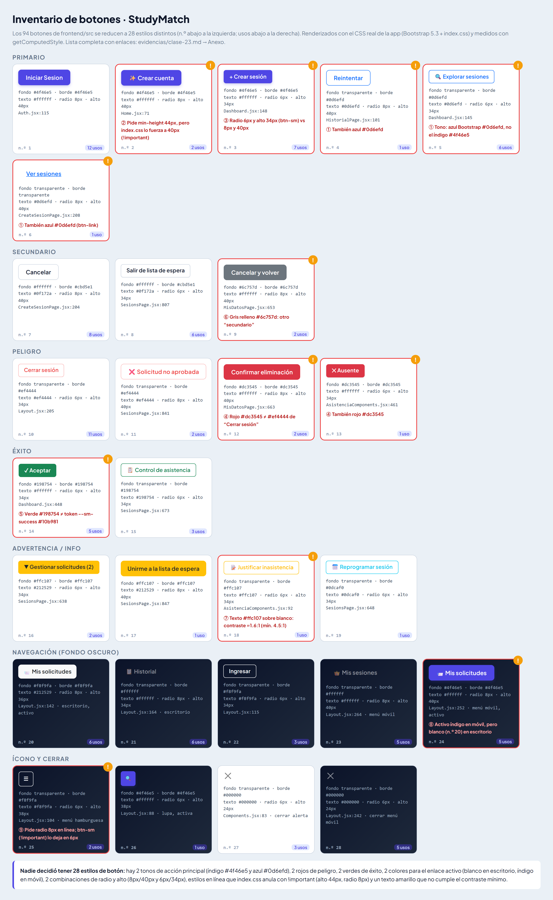

# Clase 23 · Inventario y tokens
Integrantes: Fernando Calani | Modalidad: con IA

> Todas las ubicaciones son enlaces directos a la línea de código: en GitHub abren el archivo con la línea resaltada, y en VS Code (Ctrl+clic) abren el archivo en esa línea.

---

## 1. Inventario

Revisé **todos los botones** de `frontend/src` (cualquier elemento con la clase `.btn` o `.btn-close`): son **94 botones**, que se reducen a **28 estilos distintos**. La captura muestra un ejemplar de cada estilo, agrupado por tipo, con su número (abajo a la izquierda) y cuántas veces se usa (abajo a la derecha). Cada uno está dibujado con el CSS real de la app (Bootstrap 5.3 + [`index.css`](../frontend/src/index.css)), y sus valores se midieron en el navegador con `getComputedStyle`. La lista de los 94 botones, con su enlace, está en el [Anexo](#anexo--los-94-botones-de-la-app).



### Diferencias encontradas (lo que debería ser igual y no lo es)

| # | Tipo de diferencia | Qué pasa | Dónde |
| --- | --- | --- | --- |
| ① | **Tono casi igual** | La acción principal tiene dos azules: `btn-primary` es índigo `#4f46e5`, pero `btn-outline-primary` y `btn-link` usan el azul de Bootstrap `#0d6efd`, porque `index.css` solo sobrescribe `btn-primary`. | [Dashboard.jsx:145](../frontend/src/Dashboard.jsx#L145) «🔍 Explorar sesiones» · [HistorialPage.jsx:101](../frontend/src/HistorialPage.jsx#L101) · [CreateSesionPage.jsx:208](../frontend/src/CreateSesionPage.jsx#L208) · regla única: [index.css:178](../frontend/src/index.css#L178) |
| ② | **Alto distinto (y no intencional)** | El Inicio pide `min-height: 44px` en línea para el área táctil, pero `.btn` tiene `min-height: 40px !important` y gana. El botón mide 40px. | [Home.jsx:60](../frontend/src/Home.jsx#L60) · [Home.jsx:71](../frontend/src/Home.jsx#L71) · [index.css:148](../frontend/src/index.css#L148) |
| ③ | **Radios y altos distintos** | `.btn` usa radio 8px y alto 40px, y `.btn-sm`, 6px y 34px. Hay acciones principales en ambos tamaños. | [Dashboard.jsx:148](../frontend/src/Dashboard.jsx#L148) frente a [Auth.jsx:115](../frontend/src/Auth.jsx#L115) · [index.css:226](../frontend/src/index.css#L226) |
| ④ | **Tono de peligro duplicado** | «Cerrar sesión» es `#ef4444` (index.css), mientras que «Confirmar eliminación», «Confirmar cancelación» y «✕ Ausente» son `#dc3545` (Bootstrap). | [Layout.jsx:205](../frontend/src/Layout.jsx#L205) · [MisDatosPage.jsx:663](../frontend/src/MisDatosPage.jsx#L663) · [SesionsPage.jsx:1043](../frontend/src/SesionsPage.jsx#L1043) · [AsistenciaComponents.jsx:461](../frontend/src/AsistenciaComponents.jsx#L461) |
| ⑤ | **Tono de éxito duplicado** | «✓ Aceptar» es `#198754` (Bootstrap), pero el verde del sistema (`--sm-success`, usado en las insignias) es `#10b981`. | [Dashboard.jsx:448](../frontend/src/Dashboard.jsx#L448) · token: [index.css:24](../frontend/src/index.css#L24) |
| ⑥ | **Relleno al azar** | Hay dos «secundarios»: de contorno blanco (`btn-outline-secondary`) y gris relleno `#6c757d` (`btn-secondary`). | [CreateSesionPage.jsx:204](../frontend/src/CreateSesionPage.jsx#L204) · [MisDatosPage.jsx:653](../frontend/src/MisDatosPage.jsx#L653) · [SesionsPage.jsx:754](../frontend/src/SesionsPage.jsx#L754) |
| ⑦ | **Contraste** | «📝 Justificar inasistencia» usa texto `#ffc107` sobre blanco: contraste de ≈1.6:1, cuando el mínimo de WCAG es 4.5:1. | [AsistenciaComponents.jsx:92](../frontend/src/AsistenciaComponents.jsx#L92) |
| ⑧ | **Estado activo distinto** | El enlace de la página actual es blanco (`btn-light`) en el navbar de escritorio e índigo (`btn-primary`) en el menú móvil. | [Layout.jsx:142](../frontend/src/Layout.jsx#L142) · [Layout.jsx:252](../frontend/src/Layout.jsx#L252) |
| ⑨ | **Radio anulado** | Los botones 🔍 y ☰ piden `borderRadius: 8px` en línea, pero `.btn-sm` fuerza 6px con `!important`. Miden 6px. | [Layout.jsx:93](../frontend/src/Layout.jsx#L93) · [Layout.jsx:105](../frontend/src/Layout.jsx#L105) · [index.css:230](../frontend/src/index.css#L230) |
| — | **Estados que faltan** | Solo `btn-primary` tiene `:hover`, `:focus` y `:active` propios. `btn-outline-secondary` y `btn-outline-danger` solo tienen `:hover`. Los de éxito, advertencia, info y `btn-outline-primary` usan los estados por defecto de Bootstrap, con otros colores. Ningún botón tiene un estado «cargando» con estilo propio: solo cambia el texto. | [index.css:185](../frontend/src/index.css#L185) · [index.css:193](../frontend/src/index.css#L193) · [index.css:205](../frontend/src/index.css#L205) · [index.css:219](../frontend/src/index.css#L219) |

---

## 2. Tokens

Cinco tokens nombrados **por uso, no por apariencia**. La app todavía no tiene tema oscuro: los valores oscuros son la propuesta para ese modo. Todavía no se modificó el código.

| Token | Claro | Oscuro (propuesta) | Dónde se usa | Hoy en el código |
| --- | --- | --- | --- | --- |
| `color-accion` | `#4f46e5` | `#5b54eb` (se descartó `#818cf8`: con texto blanco da 2.9:1; `#5b54eb` da 5.37:1, cumple AA) | Botón primario: [.btn-primary](../frontend/src/index.css#L178) («[Iniciar Sesion](../frontend/src/Auth.jsx#L115)», «[Solicitar unirme](../frontend/src/SesionsPage.jsx#L856)»). Enlaces: [a](../frontend/src/index.css#L81). Ítem activo del [menú móvil](../frontend/src/Layout.jsx#L252). [Foco de los inputs](../frontend/src/index.css#L255) | [`--sm-primary` (index.css:18)](../frontend/src/index.css#L18), mezclado con `#0d6efd` de Bootstrap (ver ①) |
| `color-texto` | `#0f172a` | `#e2e8f0` | Títulos: [h1–h6](../frontend/src/index.css#L76). Texto de botones secundarios: [index.css:208](../frontend/src/index.css#L208). Texto principal de las cards y de los formularios | [`--sm-text` (index.css:35)](../frontend/src/index.css#L35), y además `#0f172a` repetido a mano en [index.css:76](../frontend/src/index.css#L76) y [index.css:208](../frontend/src/index.css#L208) |
| `color-error` | `#ef4444` | `#f87171` | [.btn-outline-danger](../frontend/src/index.css#L212): «[Cerrar sesión](../frontend/src/Layout.jsx#L205)», «[Eliminar mi cuenta](../frontend/src/MisDatosPage.jsx#L542)», «[✕ Rechazar](../frontend/src/Dashboard.jsx#L456)». Alertas y badges de error | [`--sm-danger` (index.css:28)](../frontend/src/index.css#L28), mezclado con `#dc3545` de Bootstrap (ver ④) |
| `espacio-4` | `16px` | `16px` | Separación entre campos: [Input `mb-3`](../frontend/src/Components.jsx#L58). Margen lateral de la página en móvil: [main `px-3`](../frontend/src/Layout.jsx#L328). Padding de las cards en móvil: [card-body `p-3`](../frontend/src/Dashboard.jsx#L201) | Clases de Bootstrap (`1rem`), sin un token propio |
| `radio-control` | `8px` | `8px` | Botones: [.btn](../frontend/src/index.css#L149). Inputs y selects: [.form-control](../frontend/src/index.css#L241). [.btn-outline-danger](../frontend/src/index.css#L213). [Enlaces del navbar](../frontend/src/index.css#L114) | `8px` escrito a mano en esas 4 reglas de `index.css`, sin variable |

> Los mismos nombres se usarán en las variables de Figma (con modos Claro y Oscuro) y en un único `tokens.css`.

---

## 3. Colores fijos

- **Pantalla revisada:** Analítica (`/analitica`) → [`frontend/src/AnaliticaPage.jsx`](../frontend/src/AnaliticaPage.jsx).
- **Qué buscamos:** colores escritos a mano, con **Ctrl+Shift+F** en VS Code, la expresión regular activada (`.*`) y la búsqueda limitada a ese archivo:

  ```
  #[0-9a-fA-F]{3,8}\b|rgba?\(
  ```

- **Cuántos encontramos: 7.**

| # | Ubicación | Valor | Para qué se usa |
| --- | --- | --- | --- |
| 1 | [AnaliticaPage.jsx:72](../frontend/src/AnaliticaPage.jsx#L72) | `#2d3748` | Fondo de la cabecera de desarrollo «/analitica» |
| 2 | [AnaliticaPage.jsx:115](../frontend/src/AnaliticaPage.jsx#L115) | `#c6f646` | Fondo verde lima de la métrica «% terminan» |
| 3 | [AnaliticaPage.jsx:116](../frontend/src/AnaliticaPage.jsx#L116) | `#1a202c` | Texto de esa métrica |
| 4 | [AnaliticaPage.jsx:206](../frontend/src/AnaliticaPage.jsx#L206) | `#fff3cd` | Fondo de la alerta «Paso con la mayor caída» |
| 5 | [AnaliticaPage.jsx:207](../frontend/src/AnaliticaPage.jsx#L207) | `#ffc107` | Borde izquierdo de esa alerta |
| 6 | [AnaliticaPage.jsx:268](../frontend/src/AnaliticaPage.jsx#L268) | `#10b981` | Borde de la caja «Obligatorio · Panel propio» |
| 7 | [AnaliticaPage.jsx:282](../frontend/src/AnaliticaPage.jsx#L282) | `#6366f1` | Borde de la caja «Regla IHC · Privacidad» |

Además, `#10b981` ([fila 6](../frontend/src/AnaliticaPage.jsx#L268)) ya existe como [`--sm-success`](../frontend/src/index.css#L24), pero aquí está escrito a mano. Si el verde cambiara, esta caja quedaría desactualizada.

Hoy solo se contó, no se corrigió. Como referencia, la misma búsqueda en todo `frontend/src` encuentra **66** colores fijos:

| Archivo | Colores fijos |
| --- | --- |
| [index.css](../frontend/src/index.css) | 54 |
| [AnaliticaPage.jsx](../frontend/src/AnaliticaPage.jsx) | 7 |
| [SesionsPage.jsx](../frontend/src/SesionsPage.jsx#L875) | 2 (fondo de los modales, [875](../frontend/src/SesionsPage.jsx#L875) y [980](../frontend/src/SesionsPage.jsx#L980)) |
| [AsistenciaComponents.jsx](../frontend/src/AsistenciaComponents.jsx#L293) | 2 (fondo de los modales, [293](../frontend/src/AsistenciaComponents.jsx#L293) y [743](../frontend/src/AsistenciaComponents.jsx#L743)) |
| [MisDatosPage.jsx](../frontend/src/MisDatosPage.jsx#L564) | 1 (fondo del modal, [564](../frontend/src/MisDatosPage.jsx#L564)) |

---

## Anexo · Los 94 botones de la app

Cada fila enlaza a la línea donde está el botón. La columna «Estilo» indica su número en la captura. Algunos botones cambian de estilo según el estado (por ejemplo, el enlace del navbar es n.º 20 si es la página actual y n.º 21 si no); en ese caso aparecen los dos números.

| # | Ubicación | Texto del botón | Clases | Estilo en la captura |
| --- | --- | --- | --- | --- |
| 1 | [AnaliticaPage.jsx:80](../frontend/src/AnaliticaPage.jsx#L80) | 🔄 Actualizar | `btn-outline-light · btn-sm` | 22 |
| 2 | [AsistenciaComponents.jsx:92](../frontend/src/AsistenciaComponents.jsx#L92) | 📝 Justificar inasistencia | `btn-outline-warning · btn-sm` | 18 |
| 3 | [AsistenciaComponents.jsx:307](../frontend/src/AsistenciaComponents.jsx#L307) | ✕ (cerrar: Cerrar modal) | `btn-close / btn-close-white` | 28 |
| 4 | [AsistenciaComponents.jsx:346](../frontend/src/AsistenciaComponents.jsx#L346) | 🏁 Dar sesión por concluida y habilitar asistencia | `btn-warning · btn-sm` | 16 |
| 5 | [AsistenciaComponents.jsx:425](../frontend/src/AsistenciaComponents.jsx#L425) | ✏️ Editar / Modificar asistencia | `btn-outline-primary · btn-sm` | 5 |
| 6 | [AsistenciaComponents.jsx:450](../frontend/src/AsistenciaComponents.jsx#L450) | ✓ Presente | `btn-success / btn-outline-success · btn-sm` | 14 / 15 |
| 7 | [AsistenciaComponents.jsx:461](../frontend/src/AsistenciaComponents.jsx#L461) | ✕ Ausente | `btn-danger / btn-outline-danger · btn-sm` | 13 / 10 |
| 8 | [AsistenciaComponents.jsx:480](../frontend/src/AsistenciaComponents.jsx#L480) | Cancelar | `btn-outline-secondary · btn-sm` | 8 |
| 9 | [AsistenciaComponents.jsx:497](../frontend/src/AsistenciaComponents.jsx#L497) | 💾 Guardar registro de asistencia | `btn-primary · btn-sm` | 3 |
| 10 | [AsistenciaComponents.jsx:586](../frontend/src/AsistenciaComponents.jsx#L586) | ✓ Aceptar justificación | `btn-success · btn-sm` | 14 |
| 11 | [AsistenciaComponents.jsx:594](../frontend/src/AsistenciaComponents.jsx#L594) | ✕ Rechazar justificación | `btn-outline-danger · btn-sm` | 10 |
| 12 | [AsistenciaComponents.jsx:682](../frontend/src/AsistenciaComponents.jsx#L682) | Cerrar | `btn-outline-secondary · btn-sm` | 8 |
| 13 | [AsistenciaComponents.jsx:756](../frontend/src/AsistenciaComponents.jsx#L756) | ✕ (cerrar: Cerrar modal) | `btn-close` | 27 |
| 14 | [AsistenciaComponents.jsx:791](../frontend/src/AsistenciaComponents.jsx#L791) | Cancelar | `btn-outline-secondary · btn-sm` | 8 |
| 15 | [AsistenciaComponents.jsx:798](../frontend/src/AsistenciaComponents.jsx#L798) | Enviar justificación | `btn-primary · btn-sm` | 3 |
| 16 | [Auth.jsx:115](../frontend/src/Auth.jsx#L115) | Iniciar Sesion | `btn-primary` | 1 |
| 17 | [Auth.jsx:267](../frontend/src/Auth.jsx#L267) | Registrarse | `btn-primary` | 1 |
| 18 | [Auth.jsx:278](../frontend/src/Auth.jsx#L278) | ← Cancelar y volver al inicio | `btn-outline-secondary` | 7 |
| 19 | [Components.jsx:83](../frontend/src/Components.jsx#L83) | ✕ (cerrar: Close) | `btn-close` | 27 |
| 20 | [CreateSesionPage.jsx:196](../frontend/src/CreateSesionPage.jsx#L196) | Crear sesión | `btn-primary` | 1 |
| 21 | [CreateSesionPage.jsx:204](../frontend/src/CreateSesionPage.jsx#L204) | Cancelar | `btn-outline-secondary` | 7 |
| 22 | [CreateSesionPage.jsx:208](../frontend/src/CreateSesionPage.jsx#L208) | Ver sesiones | `btn-link` | 6 |
| 23 | [Dashboard.jsx:145](../frontend/src/Dashboard.jsx#L145) | 🔍 Explorar sesiones | `btn-outline-primary · btn-sm` | 5 |
| 24 | [Dashboard.jsx:148](../frontend/src/Dashboard.jsx#L148) | + Crear sesión | `btn-primary · btn-sm` | 3 |
| 25 | [Dashboard.jsx:190](../frontend/src/Dashboard.jsx#L190) | 🔍 Buscar sesiones disponibles | `btn-primary` | 1 |
| 26 | [Dashboard.jsx:312](../frontend/src/Dashboard.jsx#L312) | 🔍 Ver sesión | `btn-outline-primary · btn-sm` | 5 |
| 27 | [Dashboard.jsx:321](../frontend/src/Dashboard.jsx#L321) | Cancelar solicitud | `btn-outline-danger · btn-sm` | 10 |
| 28 | [Dashboard.jsx:358](../frontend/src/Dashboard.jsx#L358) | + Crear nueva sesión | `btn-primary · btn-sm` | 3 |
| 29 | [Dashboard.jsx:367](../frontend/src/Dashboard.jsx#L367) | + Crear sesión de estudio | `btn-primary` | 1 |
| 30 | [Dashboard.jsx:397](../frontend/src/Dashboard.jsx#L397) | 📋 Tomar asistencia: … | `btn-primary · btn-sm` | 3 |
| 31 | [Dashboard.jsx:448](../frontend/src/Dashboard.jsx#L448) | ✓ Aceptar | `btn-success · btn-sm` | 14 |
| 32 | [Dashboard.jsx:456](../frontend/src/Dashboard.jsx#L456) | ✕ Rechazar | `btn-outline-danger · btn-sm` | 10 |
| 33 | [HistorialPage.jsx:85](../frontend/src/HistorialPage.jsx#L85) | 🔍 Buscar sesiones | `btn-primary` | 1 |
| 34 | [HistorialPage.jsx:88](../frontend/src/HistorialPage.jsx#L88) | Volver al panel | `btn-outline-secondary` | 7 |
| 35 | [HistorialPage.jsx:101](../frontend/src/HistorialPage.jsx#L101) | Reintentar | `btn-outline-primary` | 4 |
| 36 | [Home.jsx:60](../frontend/src/Home.jsx#L60) | 🚀 Ir a mi espacio | `btn-primary` | 2 |
| 37 | [Home.jsx:71](../frontend/src/Home.jsx#L71) | ✨ Crear cuenta | `btn-primary` | 2 |
| 38 | [Home.jsx:78](../frontend/src/Home.jsx#L78) | 🔑 Iniciar sesión | `btn-outline-secondary` | 7 |
| 39 | [Layout.jsx:88](../frontend/src/Layout.jsx#L88) | 🔍 | `btn-primary / btn-outline-light · btn-sm` | 26 / 25 |
| 40 | [Layout.jsx:104](../frontend/src/Layout.jsx#L104) | ☰ | `btn-outline-light · btn-sm` | 25 |
| 41 | [Layout.jsx:115](../frontend/src/Layout.jsx#L115) | Ingresar | `btn-outline-light · btn-sm` | 22 |
| 42 | [Layout.jsx:131](../frontend/src/Layout.jsx#L131) | 🔍 Buscar sesiones | `btn-light / btn-outline-light · btn-sm` | 20 / 21 |
| 43 | [Layout.jsx:142](../frontend/src/Layout.jsx#L142) | 📨 Mis solicitudes | `btn-light / btn-outline-light · btn-sm` | 20 / 21 |
| 44 | [Layout.jsx:153](../frontend/src/Layout.jsx#L153) | 👑 Mis sesiones | `btn-light / btn-outline-light · btn-sm` | 20 / 21 |
| 45 | [Layout.jsx:164](../frontend/src/Layout.jsx#L164) | 📋 Historial | `btn-light / btn-outline-light · btn-sm` | 20 / 21 |
| 46 | [Layout.jsx:176](../frontend/src/Layout.jsx#L176) | 📊 Analítica | `btn-light / btn-outline-light · btn-sm` | 20 / 21 |
| 47 | [Layout.jsx:188](../frontend/src/Layout.jsx#L188) | 🔒 Mis datos | `btn-light / btn-outline-light · btn-sm` | 20 / 21 |
| 48 | [Layout.jsx:205](../frontend/src/Layout.jsx#L205) | Cerrar sesión | `btn-outline-danger · btn-sm` | 10 |
| 49 | [Layout.jsx:215](../frontend/src/Layout.jsx#L215) | Iniciar sesión | `btn-outline-light · btn-sm` | 22 |
| 50 | [Layout.jsx:218](../frontend/src/Layout.jsx#L218) | Registrarse | `btn-primary · btn-sm` | 3 |
| 51 | [Layout.jsx:242](../frontend/src/Layout.jsx#L242) | ✕ (cerrar: Cerrar menú) | `btn-close / btn-close-white` | 28 |
| 52 | [Layout.jsx:252](../frontend/src/Layout.jsx#L252) | 📨 Mis solicitudes | `btn-primary / btn-outline-light` | 24 / 23 |
| 53 | [Layout.jsx:264](../frontend/src/Layout.jsx#L264) | 👑 Mis sesiones | `btn-primary / btn-outline-light` | 24 / 23 |
| 54 | [Layout.jsx:276](../frontend/src/Layout.jsx#L276) | 📋 Historial | `btn-primary / btn-outline-light` | 24 / 23 |
| 55 | [Layout.jsx:288](../frontend/src/Layout.jsx#L288) | 📊 Analítica | `btn-primary / btn-outline-light` | 24 / 23 |
| 56 | [Layout.jsx:300](../frontend/src/Layout.jsx#L300) | 🔒 Mis datos y salida honesta | `btn-primary / btn-outline-light` | 24 / 23 |
| 57 | [Layout.jsx:317](../frontend/src/Layout.jsx#L317) | 🚪 Cerrar sesión | `btn-outline-danger` | 11 |
| 58 | [MisDatosPage.jsx:280](../frontend/src/MisDatosPage.jsx#L280) | 📥 Descargar en JSON | `btn-outline-primary · btn-sm` | 5 |
| 59 | [MisDatosPage.jsx:289](../frontend/src/MisDatosPage.jsx#L289) | 📊 Descargar en CSV | `btn-outline-success · btn-sm` | 15 |
| 60 | [MisDatosPage.jsx:422](../frontend/src/MisDatosPage.jsx#L422) | ✏️ Cambiar mi contraseña | `btn-outline-primary · btn-sm` | 5 |
| 61 | [MisDatosPage.jsx:475](../frontend/src/MisDatosPage.jsx#L475) | Cancelar | `btn-outline-secondary · btn-sm` | 8 |
| 62 | [MisDatosPage.jsx:488](../frontend/src/MisDatosPage.jsx#L488) | Guardar nueva contraseña | `btn-primary · btn-sm` | 3 |
| 63 | [MisDatosPage.jsx:542](../frontend/src/MisDatosPage.jsx#L542) | Eliminar mi cuenta permanentemente | `btn-outline-danger · btn-sm` | 10 |
| 64 | [MisDatosPage.jsx:577](../frontend/src/MisDatosPage.jsx#L577) | ✕ (cerrar: Cerrar modal) | `btn-close` | 27 |
| 65 | [MisDatosPage.jsx:653](../frontend/src/MisDatosPage.jsx#L653) | Cancelar y volver | `btn-secondary` | 9 |
| 66 | [MisDatosPage.jsx:663](../frontend/src/MisDatosPage.jsx#L663) | Confirmar eliminación | `btn-danger` | 12 |
| 67 | [Recover.jsx:81](../frontend/src/Recover.jsx#L81) | Generar código | `btn-primary` | 1 |
| 68 | [Recover.jsx:103](../frontend/src/Recover.jsx#L103) | Cambiar contraseña | `btn-primary` | 1 |
| 69 | [SesionsPage.jsx:397](../frontend/src/SesionsPage.jsx#L397) | + Crear nueva sesión | `btn-primary` | 1 |
| 70 | [SesionsPage.jsx:467](../frontend/src/SesionsPage.jsx#L467) | Buscar | `btn-primary` | 1 |
| 71 | [SesionsPage.jsx:468](../frontend/src/SesionsPage.jsx#L468) | Limpiar filtros | `btn-outline-secondary` | 7 |
| 72 | [SesionsPage.jsx:483](../frontend/src/SesionsPage.jsx#L483) | ✕ (cerrar: Quitar filtro …) | `btn-close / btn-close-white` | 28 |
| 73 | [SesionsPage.jsx:638](../frontend/src/SesionsPage.jsx#L638) | ▼ Gestionar solicitudes (…) | `btn-outline-secondary / btn-warning / btn-outline-primary · btn-sm` | 8 / 16 / 5 |
| 74 | [SesionsPage.jsx:648](../frontend/src/SesionsPage.jsx#L648) | 📅 Reprogramar sesión | `btn-outline-info · btn-sm` | 19 |
| 75 | [SesionsPage.jsx:661](../frontend/src/SesionsPage.jsx#L661) | 🚫 Cancelar sesión | `btn-outline-danger · btn-sm` | 10 |
| 76 | [SesionsPage.jsx:673](../frontend/src/SesionsPage.jsx#L673) | 📋 Control de asistencia y justificaciones | `btn-outline-success · btn-sm` | 15 |
| 77 | [SesionsPage.jsx:707](../frontend/src/SesionsPage.jsx#L707) | ✓ Aceptar | `btn-success · btn-sm` | 14 |
| 78 | [SesionsPage.jsx:715](../frontend/src/SesionsPage.jsx#L715) | ✕ Rechazar | `btn-outline-danger · btn-sm` | 10 |
| 79 | [SesionsPage.jsx:754](../frontend/src/SesionsPage.jsx#L754) | 🚫 No se admiten nuevas solicitudes | `btn-secondary` | 9 |
| 80 | [SesionsPage.jsx:770](../frontend/src/SesionsPage.jsx#L770) | ✅ Aceptar nueva fecha | `btn-success · btn-sm` | 14 |
| 81 | [SesionsPage.jsx:778](../frontend/src/SesionsPage.jsx#L778) | 🚪 Retirarme | `btn-outline-danger · btn-sm` | 10 |
| 82 | [SesionsPage.jsx:793](../frontend/src/SesionsPage.jsx#L793) | Cancelar solicitud | `btn-outline-danger · btn-sm` | 10 |
| 83 | [SesionsPage.jsx:807](../frontend/src/SesionsPage.jsx#L807) | Salir de lista de espera | `btn-outline-secondary · btn-sm` | 8 |
| 84 | [SesionsPage.jsx:833](../frontend/src/SesionsPage.jsx#L833) | Abandonar sesión | `btn-outline-danger · btn-sm` | 10 |
| 85 | [SesionsPage.jsx:841](../frontend/src/SesionsPage.jsx#L841) | ❌ Solicitud no aprobada | `btn-outline-danger` | 11 |
| 86 | [SesionsPage.jsx:847](../frontend/src/SesionsPage.jsx#L847) | Unirme a la lista de espera | `btn-warning` | 17 |
| 87 | [SesionsPage.jsx:856](../frontend/src/SesionsPage.jsx#L856) | Solicitar unirme | `btn-primary` | 1 |
| 88 | [SesionsPage.jsx:883](../frontend/src/SesionsPage.jsx#L883) | ✕ (cerrar: Cerrar) | `btn-close / btn-close-white` | 28 |
| 89 | [SesionsPage.jsx:934](../frontend/src/SesionsPage.jsx#L934) | Cancelar | `btn-outline-secondary` | 7 |
| 90 | [SesionsPage.jsx:941](../frontend/src/SesionsPage.jsx#L941) | Confirmar reprogramación | `btn-primary` | 1 |
| 91 | [SesionsPage.jsx:990](../frontend/src/SesionsPage.jsx#L990) | ✕ (cerrar: Cerrar) | `btn-close / btn-close-white` | 28 |
| 92 | [SesionsPage.jsx:1033](../frontend/src/SesionsPage.jsx#L1033) | Volver sin cancelar | `btn-outline-secondary` | 7 |
| 93 | [SesionsPage.jsx:1043](../frontend/src/SesionsPage.jsx#L1043) | Confirmar cancelación | `btn-danger` | 12 |
| 94 | [SesionsPage.jsx:1056](../frontend/src/SesionsPage.jsx#L1056) | Volver al panel principal | `btn-outline-secondary` | 7 |

