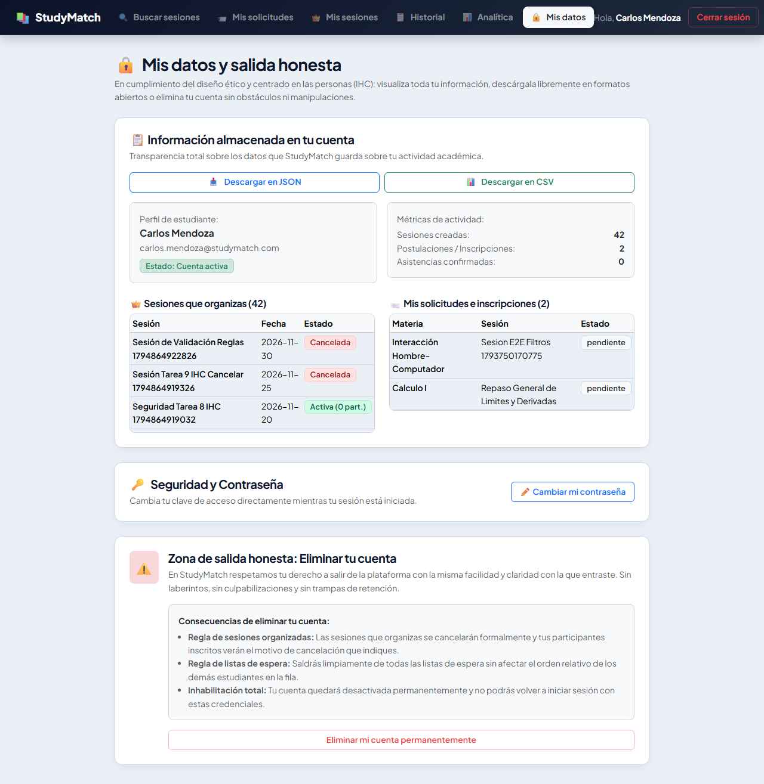
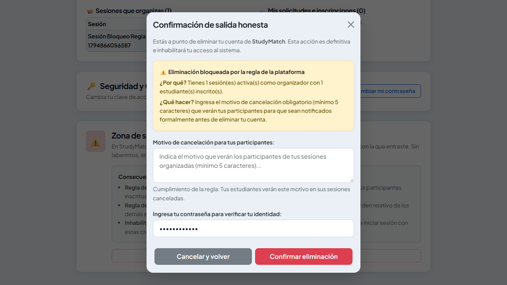
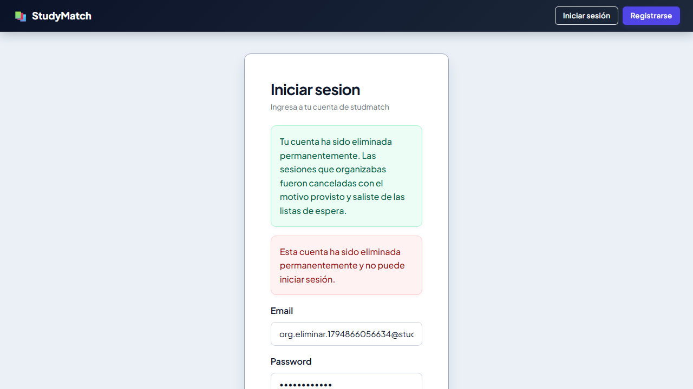
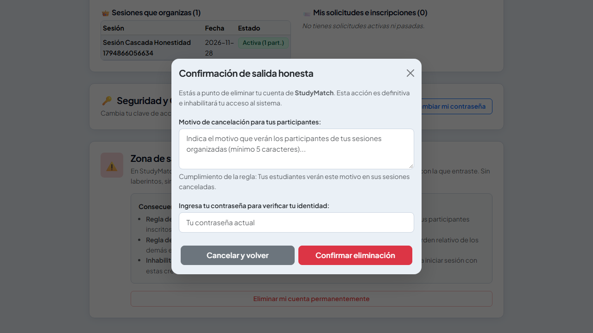

# Tarea 10 · Mis datos y salida honesta
## Portabilidad de datos, confirmación simétrica y resolución ética de la regla de la app

**Materia:** Interacción Hombre-Computador (IHC)  
**Fecha de Entrega:** Lunes 16/11/2026, 23:59  
**Integrantes:** Fernando Calani  
**Modalidad:** Con IA  
**Proyecto:** **StudyMatch** (Fork)  
**Repositorio:** [https://github.com/FernandojCg737/2do-Proyecto-Fork.git](https://github.com/FernandojCg737/2do-Proyecto-Fork.git)  

---

## 1. Filosofía de IHC: Salida Tan Clara Como la Entrada

Siguiendo las directrices de la **Clase 22 (Patrones Oscuros)** y las Diapositivas 12/16 y 13/16:

> **«La salida tiene que ser tan clara como la entrada: el usuario puede ver sus datos, descargarlos y eliminar su cuenta sin obstáculos.»**  
> *«Eliminar la cuenta no es borrar una fila. Cada app tiene datos que afectan a otras personas. Esta es la regla difícil que tienen que resolver.»*

En el diseño centrado en el usuario, la retención forzada a través de laberintos (*Roach Motel*), preguntas culpabilizantes (*Confirmshaming*) o asimetría visual en los botones constituye una violación directa a la autonomía y dignidad del estudiante. La **Tarea 10** implementa una salida simétrica, transparente y honesta, garantizando al mismo tiempo que la salida de un usuario no perjudique a los compañeros con quienes compartía actividades de estudio.

---

## 2. Mis Datos: Ver y Descargar (JSON y CSV)

### 2.1. Visualización y Transparencia
En la ruta `/mis-datos` (accesible mediante el nuevo botón en la barra superior y el selector de pestañas `NavPills`), el estudiante puede auditar de forma inmediata:
1. **Perfil de usuario:** Nombre, correo electrónico y estado de cuenta.
2. **Métricas de actividad:** Cantidad de sesiones creadas, postulaciones realizadas y asistencias confirmadas.
3. **Listado detallado:** Resumen de sesiones donde es organizador y sesiones donde es participante.



### 2.2. Portabilidad de Datos sin Obstáculos
Se implementó la exportación en dos formatos abiertos estándar:
* **JSON (`studymatch_mis_datos.json`):** Estructura jerárquica con serialización completa del perfil, sesiones e inscripciones.
* **CSV (`studymatch_mis_datos.csv`):** Formato plano y tabular legible en cualquier software de hojas de cálculo (Excel, LibreOffice, Google Sheets).

Ambos procesos disparan telemetría anónima (`descarga_datos_iniciada` y `descarga_datos_completada`) sin recopilar correos ni identidades.

---

## 3. La Regla Difícil de StudyMatch (Diapositiva 13/16)

> ### Regla asignada:
> **«Las sesiones que organiza se cancelan y los participantes ven el motivo. Sale de las listas de espera sin afectar el orden de los demás.»**  
> *«si la regla bloquea la eliminación, el mensaje dice por qué y qué hacer para poder eliminarla.»*

### 3.1. Caso 1: Intento Bloqueado por la Regla de la App
Si un organizador tiene sesiones activas (futuras o con inscripciones abiertas) que cuentan con estudiantes inscritos (en estado `aceptada`, `pendiente`, `en_espera` o `pendiente_reconfirmacion`), el sistema **no le permite eliminar su cuenta de manera descuidada dejando a sus compañeros desamparados**.

Si el usuario intenta confirmar la eliminación **sin proveer un motivo de cancelación** (o menor a 5 caracteres):
* **Respuesta HTTP:** `400 Bad Request`.
* **Mensaje en la interfaz:**
  * **¿Por qué?** *«Tienes N sesión(es) activa(s) como organizador con M estudiante(s) inscrito(s).»*
  * **¿Qué hacer?** *«Ingresa el motivo de cancelación obligatorio (mínimo 5 caracteres) que verán tus participantes para que sean notificados formalmente antes de eliminar tu cuenta.»*



### 3.2. Caso 2: Eliminación Completa y en Cascada
Cuando el organizador ingresa el motivo y confirma su contraseña:
1. **Cancelación en cascada:** Todas sus sesiones activas pasan a `cancelada = True`, se guarda el `motivo_cancelacion` provisto por el organizador y se sella la `fecha_cancelacion`. Todas las solicitudes asociadas pasan a `cancelada` para que los estudiantes vean el motivo en sus paneles.
2. **Salida limpia de listas de espera:** Si el usuario que se da de baja estaba en lista de espera (`en_espera`) de una sesión ajena, su registro se retira de la fila. Las consultas FIFO (`fecha_inscripcion ASC`) recompactan automáticamente las posiciones (#2 pasa a ser #1) **sin alterar el orden cronológico relativo de los demás estudiantes**. Si estaba en estado `aceptada`, se promueve automáticamente al primer estudiante en espera.
3. **Inhabilitación permanente de la cuenta:** El usuario se marca como `activo = False` y se sella `fecha_eliminacion`.
4. **Bloqueo absoluto de inicio de sesión:** La cuenta **nunca más puede autenticarse**. Si intenta ingresar credenciales en `/login`, el sistema rechaza la petición con `HTTP 401 Unauthorized`: *«Esta cuenta ha sido eliminada permanentemente y no puede iniciar sesión.»*



---

## 4. Confirmación Honesta (Diseño Ético)

En cumplimiento de las directrices de la Diapositiva 12/16:



1. **Simetría visual:** Los botones `Cancelar y volver` y `Confirmar eliminación` tienen exactamente el mismo ancho (`w-50`), el mismo relleno vertical y la misma jerarquía de accesibilidad (Ley de Fitts). No se esconde la opción de eliminación en un enlace diminuto ni se agranda el botón de permanencia.
2. **Consecuencias explícitas:** El modal detalla exactamente qué ocurrirá con las sesiones organizadas, las listas de espera y las credenciales.
3. **Cero manipulación emocional (*No Confirmshaming*):** Se erradicó cualquier texto del tipo *"¿Seguro que nos quieres abandonar? Tus amigos te van a extrañar 😢"*. El lenguaje es puramente factual y respetuoso.
4. **Prevención de errores (Heurística de Nielsen #5):** Se solicita reingresar la contraseña actual para verificar que el usuario sea realmente el propietario de la cuenta y evitar eliminaciones involuntarias.

---

## 5. Revisión de los Seis Patrones Oscuros en Toda la App

La Diapositiva 12/16 exige una auditoría global de los 6 tipos de patrones oscuros en el producto:

| N° | Tipo de Patrón Oscuro | Dónde se auditó en StudyMatch | Estado | Acción / Justificación de Diseño Ético Aplicado |
| :---: | :--- | :--- | :---: | :--- |
| **1** | **Jerarquía engañosa** *(Confirmshaming / Visual Misdirection)* | Modal de eliminación de cuenta y modales de cancelación | ✅ Corregido | Se aplicó simetría total: botones del mismo tamaño (`w-50`), tipografía neutra y colores informativos estándar sin desviar la mirada ni ridiculizar la salida. |
| **2** | **Obstáculos para salir** *(Roach Motel / Asimetría)* | Flujo de eliminación de cuenta y retiro de sesiones | ✅ Corregido | Salida directa y accesible desde `/mis-datos`. Se elimina en 1 solo paso con contraseña, sin cuestionarios engañosos ni pasos innecesarios. |
| **3** | **Urgencia, culpa o escasez falsas** | Detalle de cupos en tarjetas de sesión (`SesionsPage.jsx`) | ✅ Corregido | Erradicado en la Clase 22. Se eliminó el badge estático *«⚡ ¡Últimos cupos!»*. Ahora se calcula con verdad matemática desde `sesion.cupos_disponibles`. |
| **4** | **Costos o cargos ocultos** *(Drip Pricing)* | Creación e inscripción a sesiones de estudio | ✅ No aplica / Transparente | StudyMatch es una plataforma académica libre entre estudiantes. No existen tarifas ocultas, suscripciones ni cargos imprevistos. |
| **5** | **Consentimiento forzado o engañoso** | Formularios de registro y alta de sesiones | ✅ Corregido | Ningún control ni casilla viene premarcada por defecto. Cada selección (modalidad, fecha, cupo) requiere decisión voluntaria del usuario. |
| **6** | **Manipulación emocional** | Avisos de cancelación y abandono de sesión | ✅ Corregido | Se utiliza lenguaje asertivo, objetivo y neutro. Se eliminaron emojis lacrimógenos y frases coercitivas. |

---

## 6. Telemetría y Analítica de Interacción (Diapositivas 8/13 y 12/16)

Siguiendo la regla de privacidad de IHC: **«Registren la acción, no a la persona; sin datos personales»**:

| Evento | Cuándo se dispara | Propiedades analíticas registradas |
| :--- | :--- | :--- |
| `descarga_datos_iniciada` | Al pulsar el botón de descarga | `{ "formato": "json" \| "csv" }` |
| `descarga_datos_completada` | Al descargarse el archivo generado | `{ "formato": "json" \| "csv", "total_sesiones": N }` |
| `eliminacion_cuenta_iniciada` | Al abrir el modal de salida honesta | `{ "tiene_sesiones_activas": true \| false }` |
| `eliminacion_cuenta_bloqueada` | Cuando la regla de la app frena la salida | `{ "razon": "motivo_cancelacion_requerido", "sesiones_afectadas": N }` |
| `eliminacion_cuenta_completada`| Al procesar la eliminación exitosa | `{ "sesiones_canceladas": N, "filas_espera_liberadas": N }` |

*Cualquier intento de inyectar campos personales (`email`, `nombre`, `password`) es interceptado y purgado en el validador Pydantic `filtrar_privacidad` del backend antes de tocar la base de datos.*

---

## 7. Resultados de la Suite E2E de Playwright

Archivo de pruebas: [tests/tarea10_salida_honesta.spec.ts](file:///D:/INTERACCION%20HOMBRE-COMPUTADOR/Segundo%20Proyecto%20Fork/tests/tarea10_salida_honesta.spec.ts)

```text
Running 4 tests using 4 workers

✓ 1. Mis datos: Ver expediente y descargar en formatos abiertos (JSON y CSV) (PASSED)
✓ 2. Intento bloqueado: La regla de la app bloquea la eliminación si hay sesiones activas sin motivo y explica por qué y qué hacer (PASSED)
✓ 3. Eliminación honesta completa: Cancela sesiones con motivo visible, limpia listas de espera y desactiva cuenta (PASSED)
✓ 4. Telemetría y Privacidad: Registra eventos de salida honesta en la tabla analítica sin datos personales (PASSED)

4 passed (5.8s) - 0 errores
```

### Comprobación de no regresión en toda la aplicación:
Ejecución conjunta de las 4 suites del proyecto:
```text
Running 12 tests using 6 workers
✓ 3 tests clase21_analitica.spec.ts (PASSED)
✓ 2 tests clase22_patrones_oscuros.spec.ts (PASSED)
✓ 3 tests tarea9_cancelar_sesion.spec.ts (PASSED)
✓ 4 tests tarea10_salida_honesta.spec.ts (PASSED)
12 passed (17.4s) - 0 errores
```

