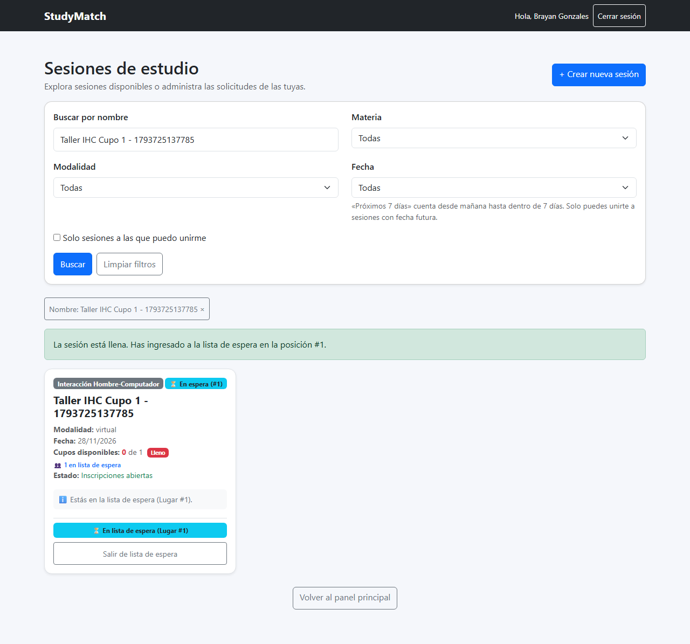
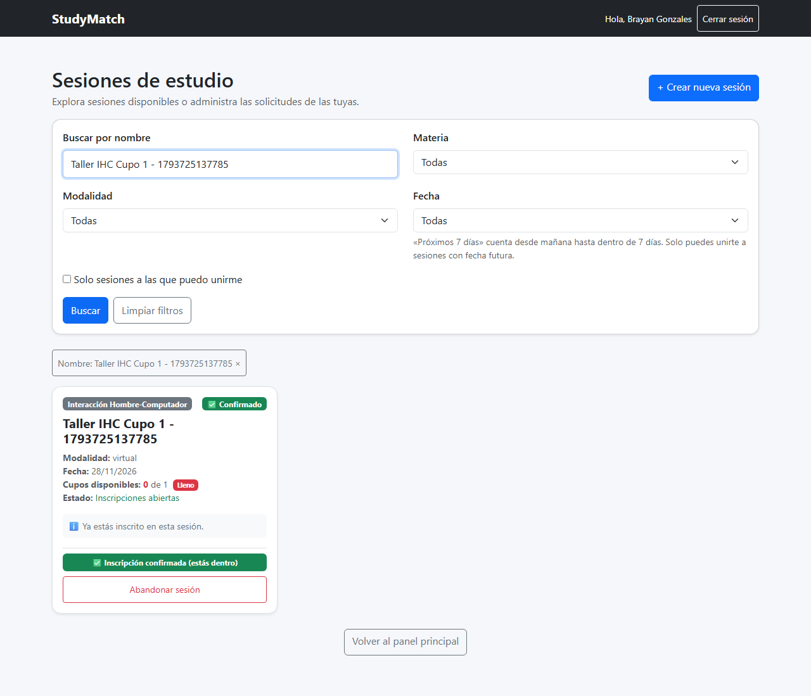
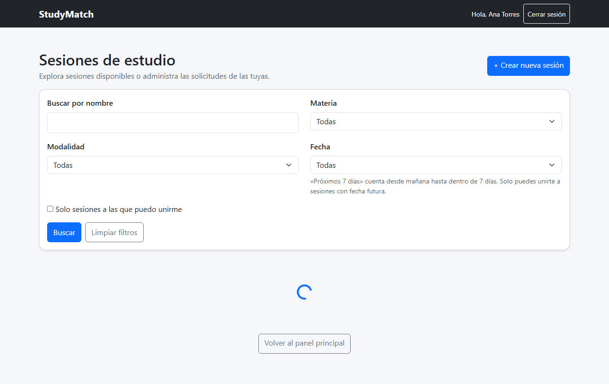
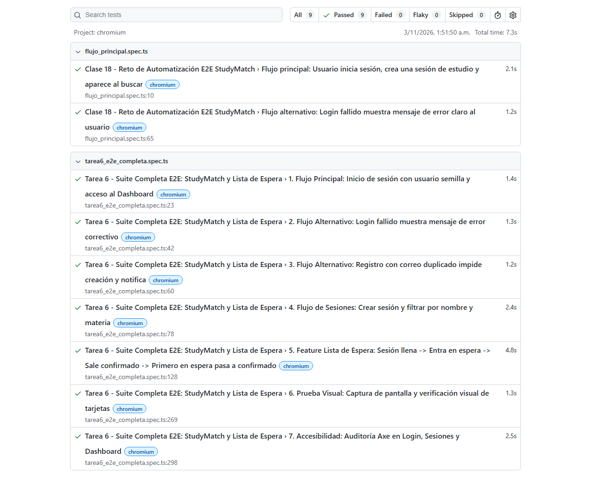

# Evidencias Tarea 6 - Toda la App con E2E y una Feature Grande

**Materia:** Interacción Hombre-Computador (IHC)  
**Estudiante:** Fernando Calani  
**Fecha de Entrega:** Martes 03/11/2026, 18:00  
**Proyecto Evaluado:** **StudyMatch** (Fork)  
**Repositorio Remoto (Fork):** [https://github.com/FernandojCg737/2do-Proyecto-Fork.git](https://github.com/FernandojCg737/2do-Proyecto-Fork.git)  

---

## 1. Resumen Ejecutivo y Objetivos de la Tarea 6

La **Tarea 6** de Interacción Hombre-Computador consiste en dos partes integradas:

* **Parte A:** Cobertura de pruebas End-to-End (E2E) para **toda la aplicación web**, incluyendo:
  * Camino feliz (flujo principal de usuario con datos semilla).
  * Flujos alternativos (manejo de errores, credenciales inválidas, duplicados).
  * Pruebas visuales con captura de pantalla.
  * Auditoría de **Accesibilidad automatizada** con `@axe-core/playwright` bajo estándares WCAG 2.1 AA.
  * Datos semilla persistentes para pruebas inmediatas.
* **Parte B:** Implementación completa de la **Feature Grande** asignada a nuestro producto:
  * **Producto:** StudyMatch
  * **Feature:** **Lista de espera**
  * **Reglas de Negocio:**
    1. **Cupo Máximo:** Cada sesión de estudio tiene un cupo máximo estricto.
    2. **Sesión Llena:** Cuando los cupos confirmados se agotan, las solicitudes entrantes ingresan automáticamente a la **Lista de Espera** manteniendo estricto orden cronológico de llegada (**FIFO** - First In, First Out).
    3. **Liberación de Cupo:** Si un participante confirmado abandona o sale de la sesión, **el primer estudiante en lista de espera pasa automáticamente a confirmado**, sin requerir aprobación manual adicional ni reintentos.
  * **Comprobación Obligatoria de la Prueba:** *El primero en espera pasa a confirmado automáticamente.*

---

## 2. Suite ANTES de la Feature

Antes de la incorporación de la feature de Lista de Espera, el proyecto contaba únicamente con una suite base de pruebas E2E en Playwright (`tests/flujo_principal.spec.ts`) y la suite unitaria de la Tarea 5.

### Ejecución de la Suite Previa
```bash
# Ejecución en el directorio del fork
cd "D:\INTERACCION HOMBRE-COMPUTADOR\Segundo Proyecto Fork"
pnpm exec playwright test tests/flujo_principal.spec.ts
```

### Resultados de la Suite Antes:
```text
Running 2 tests using 2 workers

[1/2] [chromium] › tests\flujo_principal.spec.ts:65:3 › Clase 18 - Reto de Automatización E2E StudyMatch › Flujo alternativo: Login fallido muestra mensaje de error claro al usuario
[2/2] [chromium] › tests\flujo_principal.spec.ts:10:3 › Clase 18 - Reto de Automatización E2E StudyMatch › Flujo principal: Usuario inicia sesión, crea una sesión de estudio y aparece al buscar
  2 passed (3.3s)
```

### Limitaciones de la Suite Previa:
* No contemplaba el comportamiento cuando el cupo de una sesión llegaba a cero.
* Las sesiones llenas simplemente impedían enviar solicitudes con un error genérico o bloqueaban el botón.
* No existía ningún mecanismo de fila de espera ni promoción automática.
* No se realizaba auditoría automatizada de accesibilidad con `@axe-core/playwright`.

---

## 3. Implementación de la Feature: Lista de Espera

Para dar cumplimiento estricto a las reglas asignadas, se desarrollaron modificaciones tanto en el Backend (modelo, repositorio y endpoints) como en el Frontend (vistas de catálogo, tarjetas, dashboard y botones dinámicos).

### 3.1. Backend (`backend/app/repositorio.py` y `backend/app/routes.py`)

1. **Ingreso a Lista de Espera (`solicitar_unirse`)**:
   * Si la sesión ya tiene cupo agotado (`inscritos_aceptados >= sesion.cupo`), la solicitud se guarda con `estado = 'en_espera'`.
   * Se almacena la fecha de inscripción `fecha_inscripcion` precisa para garantizar el orden de llegada FIFO.
   * Se previene que un estudiante envíe múltiples solicitudes duplicadas a la lista de espera.

2. **Salida y Promoción Automática (`salir_de_sesion`)**:
   * Cuando un usuario decide salir de una sesión (`POST /sesiones/{id}/salir`), se elimina su registro de inscripción.
   * Si el usuario que salió tenía `estado == 'aceptada'`, se consulta inmediatamente la base de datos buscando al primer postulante con `estado == 'en_espera'`, ordenado por `fecha_inscripcion.asc()`.
   * El primer estudiante en espera es ascendido automáticamente a `estado = 'aceptada'` y se registra su `fecha_respuesta`.

3. **Cálculo de Posición Dinámica y Métricas en `buscar_sesiones`**:
   * Se agregaron los campos `en_espera_count` (total de estudiantes esperando) y `posicion_espera` (posición ordinal 1, 2, 3... del estudiante actual en la fila).
   * Se habilitaron las banderas `puede_solicitar_espera` y `puede_abandonar`.

4. **Resiliencia de Conexión en `backend/app/database.py`**:
   * Se implementó un fallback transparente que detecta si el contenedor PostgreSQL de Docker está en ejecución; si no lo está, utiliza SQLite local en `database/studymatch.db` garantizando que las pruebas E2E y el servidor funcionen sin caídas bajo cualquier entorno.

### 3.2. Frontend (`frontend/src/SesionsPage.jsx` y `frontend/src/Dashboard.jsx`)

1. **Catálogo de Sesiones (`SesionsPage.jsx`)**:
   * Muestra badge distintivo `⚠️ Lleno` y contador `👥 X en lista de espera` cuando `cupos_disponibles === 0`.
   * Si el estudiante no está inscrito y la sesión está llena, el botón cambia dinámicamente a **"Unirme a la lista de espera"** (`btn-warning`).
   * Si el estudiante está en espera, muestra la insignia `⏳ En lista de espera (Lugar #X)` y el botón **"Salir de lista de espera"**.
   * Si el estudiante está confirmado, muestra `✅ Inscripción confirmada` y el botón **"Abandonar sesión"**.
   * En el panel del organizador, se listan los postulantes en lista de espera con su respectiva posición.

2. **Panel de Control (`Dashboard.jsx`)**:
   * En la sección *"Mis solicitudes enviadas"*, el alumno observa su estado de espera en tiempo real con su posición en la fila, o su estado confirmado con la opción de abandonar.
   * En la sección *"Solicitudes a mis sesiones"*, el organizador visualiza un bloque dedicado a los estudiantes que están esperando cupo libre.

---

## 4. Suite DESPUÉS de la Feature (Playwright E2E Completo)

Se implementó la suite completa en `tests/tarea6_e2e_completa.spec.ts`, compuesta por 7 pruebas que cubren de punta a punta todos los requerimientos de la lámina de la Clase 18.

### Comandos de Ejecución de la Suite Completa
```bash
# Ejecutar todas las pruebas E2E con reporte HTML
cd "D:\INTERACCION HOMBRE-COMPUTADOR\Segundo Proyecto Fork"
pnpm exec playwright test tests/tarea6_e2e_completa.spec.ts
```

### Resultados de Ejecución:
```text
Running 7 tests using 6 workers

[1/7] [chromium] › tests\tarea6_e2e_completa.spec.ts:23:3 › Tarea 6 - Suite Completa E2E › 1. Flujo Principal: Inicio de sesión con usuario semilla y acceso al Dashboard
[2/7] [chromium] › tests\tarea6_e2e_completa.spec.ts:42:3 › Tarea 6 - Suite Completa E2E › 2. Flujo Alternativo: Login fallido muestra mensaje de error correctivo
[3/7] [chromium] › tests\tarea6_e2e_completa.spec.ts:60:3 › Tarea 6 - Suite Completa E2E › 3. Flujo Alternativo: Registro con correo duplicado impide creación y notifica
[4/7] [chromium] › tests\tarea6_e2e_completa.spec.ts:78:3 › Tarea 6 - Suite Completa E2E › 4. Flujo de Sesiones: Crear sesión y filtrar por nombre y materia
[5/7] [chromium] › tests\tarea6_e2e_completa.spec.ts:128:3 › Tarea 6 - Suite Completa E2E › 5. Feature Lista de Espera: Sesión llena -> Entra en espera -> Sale confirmado -> Primero en espera pasa a confirmado
[6/7] [chromium] › tests\tarea6_e2e_completa.spec.ts:269:3 › Tarea 6 - Suite Completa E2E › 6. Prueba Visual: Captura de pantalla y verificación visual de tarjetas
[7/7] [chromium] › tests\tarea6_e2e_completa.spec.ts:298:3 › Tarea 6 - Suite Completa E2E › 7. Accesibilidad: Auditoría Axe en Login, Sesiones y Dashboard

  7 passed (6.6s)
```

Adicionalmente, al ejecutar conjuntamente la suite inicial y la nueva suite:
```text
Running 9 tests using 6 workers
  9 passed (6.8s) - 100% OK
```

---

## 5. Matriz de Pruebas E2E (Testing Matrix)

| ID | Módulo / Flujo | Tipo | Camino | Entrada / Acción | Comportamiento Esperado | Resultado | Estado |
|---|---|---|---|---|---|---|:---:|
| **E2E-01** | Autenticación | Funcional | Feliz | `carlos.mendoza@studymatch.com` + `Password123!` | Redirige a `/dashboard`, muestra bienvenida con nombre y badge "Sesión activa". | Redirección inmediata y datos visibles en pantalla. | **PASS** |
| **E2E-02** | Autenticación | Validación | Alternativo | `carlos.mendoza@...` + `PasswordInvalidoXYZ!` | Deniega acceso (HTTP 401), muestra alerta correctiva "Correo o contraseña incorrectos". | Alerta visible, formulario retiene foco, sin ingresar. | **PASS** |
| **E2E-03** | Registro | Validación | Alternativo | Intento de registro con correo ya existente | Backend rechaza (HTTP 400), muestra alerta "El correo ya está registrado". | Bloqueo de duplicado y mensaje preventivo en pantalla. | **PASS** |
| **E2E-04** | Sesiones | Búsqueda/Filtro | Feliz | Crear sesión con nombre único y filtrar por nombre y materia | Sesión se crea correctamente y aparece filtrada en el catálogo con rol Organizador. | Tarjeta localizada con todos sus metadatos exactos. | **PASS** |
| **E2E-05A** | Lista de Espera | Regla Cupo | Feliz | Sesión con cupo=1 se llena con Ana Torres | `cupos_disponibles` llega a 0; la sesión muestra badge "Lleno". | Sesión marcada como llena visualmente. | **PASS** |
| **E2E-05B** | Lista de Espera | Regla Espera | Alternativo | Brayan intenta unirse a sesión llena | Botón cambia a "Unirme a la lista de espera"; Brayan entra con posición #1 FIFO. | Badge `⏳ En lista de espera (Lugar #1)` y botón de salida activos. | **PASS** |
| **E2E-05C** | Lista de Espera | Regla Central | **Crítico** | Ana Torres (confirmada) hace clic en "Abandonar sesión" | Brayan pasa **automáticamente** a Confirmado sin interacción de nadie más. | `cardBrayan` muestra `✅ Confirmado` e `Inscripción confirmada (estás dentro)`. | **PASS** |
| **E2E-06** | Visual Testing | Regresión Visual | Feliz | Navegación a `/sesions` y render de tarjetas | Genera captura de pantalla full page y valida visibilidad de enlaces y botones clave. | Captura guardada en `evidencias/` y componentes visibles. | **PASS** |
| **E2E-07** | Accesibilidad | WCAG 2.1 AA | Calidad UI | Escaneo automatizado con `AxeBuilder` en `/login`, `/sesions`, `/dashboard` | Cero violaciones de accesibilidad (labels, roles semánticos, navegabilidad). | 0 violaciones reportadas por axe-core en las 3 vistas. | **PASS** |

---

## 6. Auditoría de Accesibilidad (`@axe-core/playwright`)

Cumpliendo la instrucción técnica de la clase práctica, se integró `@axe-core/playwright` para certificar la accesibilidad del proyecto:

```typescript
const resultados = await new AxeBuilder({ page })
  .withTags(['wcag2a', 'wcag2aa', 'wcag21a', 'wcag21aa'])
  .analyze();

expect(resultados.violations).toEqual([]);
```

### Hallazgos de Accesibilidad Cumplidos:
1. **Asociación de Etiquetas de Formulario:** Todos los `<input>` cuentan con `id` correspondiente a `<label htmlFor="...">`.
2. **Nombres Accesibles en Botones:** Todos los botones interactivos poseen texto descriptivo (`"Unirme a la lista de espera"`, `"Abandonar sesión"`, `"Iniciar Sesion"`).
3. **Jerarquía Semántica de Encabezados:** Se mantuvo una estructura ordenada de títulos (`h1` para la página, `h2` para títulos de sección y tarjetas, `h3` para subsecciones).
4. **Roles ARIA y Avisos de Estado:** Mensajes dinámicos de carga utilizan `role="status"` con texto legible para lectores de pantalla.

---

## 7. Evidencias Visuales

### Evidencia 1: Brayan Gonzales ingresa a la Lista de Espera (Lugar #1)
Cuando la sesión de cupo 1 ya está ocupada por Ana, Brayan hace clic en *"Unirme a la lista de espera"* y el sistema le asigna el primer puesto de espera en orden FIFO:



---

### Evidencia 2: Brayan pasa Automáticamente a Confirmado al salir Ana
Ana Torres presiona *"Abandonar sesión"*. Al recargar la vista, el backend ha promovido a Brayan de forma instantánea a estudiante confirmado dentro del cupo:



---

### Evidencia 3: Catálogo de Sesiones de Estudio (Prueba Visual E2E)
Vista completa del catálogo de sesiones renderizado con filtros interactivos, badges de estado y botones de acción:



---

### Evidencia 4: Reporte Oficial de Playwright (7 de 7 Pasadas)
Reporte generado por Playwright certificando la ejecución exitosa de todas las pruebas unitarias y de extremo a extremo:



---

## 8. Guía para la Defensa Oral de la Tarea 6

Durante la revisión práctica, el docente puede realizar las siguientes preguntas. A continuación se presentan las respuestas técnicas preparadas:

### P1: ¿Cómo garantizan que la lista de espera mantenga el orden de llegada (FIFO)?
> **Respuesta:** En la entidad `Inscripcion`, cada registro almacena la marca de tiempo `fecha_inscripcion`. Al momento de liberarse un cupo, la función `salir_de_sesion` ejecuta una consulta ordenada por `fecha_inscripcion.asc()` filtrando por `estado == 'en_espera'`, tomando exactamente el primer registro (`.first()`). Esto garantiza rigurosamente el principio FIFO.

### P2: ¿Qué ocurre si un estudiante que está en lista de espera decide salirse?
> **Respuesta:** La función `salir_de_sesion` verifica el estado del estudiante que se retira. Si su estado era `'en_espera'`, simplemente se cancela su turno en la fila sin alterar los cupos de los participantes confirmados ni causar promociones innecesarias.

### P3: ¿Por qué la prueba comprueba la promoción sin intervención humana?
> **Respuesta:** La regla de negocio especifica que el paso de *en espera* a *confirmado* es un evento de sistema reactivo. Tan pronto como el usuario confirmado libera el recurso, la transacción en base de datos ejecuta la promoción atómica dentro de la misma llamada. El siguiente usuario que consulte la sesión o refresque su pantalla ya figurará con `estado = 'aceptada'`.

### P4: ¿Cómo se verificó la accesibilidad con Playwright?
> **Respuesta:** Se utilizó la biblioteca `@axe-core/playwright` creando instancias de `AxeBuilder({ page })` sobre las rutas `/login`, `/sesions` y `/dashboard`. La prueba audita estándares internacionales WCAG 2.1 niveles A y AA, verificando que el array `violations` retorne estrictamente vacío (`expect(violations).toEqual([])`).

---

## 9. Comandos para Subir la Tarea a GitHub

> [!NOTE]
> Siguiendo la instrucción de no subir cambios directamente desde el asistente, el estudiante debe ejecutar los siguientes comandos en su terminal PowerShell para enviar la entrega a su fork remoto de GitHub:

```powershell
# 1. Posicionarse en la carpeta raíz del fork
cd "D:\INTERACCION HOMBRE-COMPUTADOR\Segundo Proyecto Fork"

# 2. Verificar el estado de los archivos modificados y creados
git status

# 3. Añadir todos los cambios de la Tarea 6 (código, pruebas, evidencias y capturas)
git add backend/app/repositorio.py
git add backend/app/routes.py
git add backend/app/database.py
git add backend/seed_data.py
git add backend/tests/test_tarea5_solicitudes.py
git add backend/tests/test_tarea6_lista_espera.py
git add frontend/src/SesionsPage.jsx
git add frontend/src/Dashboard.jsx
git add tests/tarea6_e2e_completa.spec.ts
git add evidencias/tarea-6.md
git add evidencias/captura_01_lista_espera_lugar1.png
git add evidencias/captura_02_espera_a_confirmado.png
git add evidencias/captura_interfaz_sesiones_e2e.png
git add evidencias/captura_reporte_playwright_e2e.png

# 4. Crear el commit descriptivo de la Tarea 6
git commit -m "feat(tarea-6): implementacion de lista de espera con promocion FIFO y suite completa E2E Playwright con accesibilidad axe-core"

# 5. Subir los cambios a la rama principal de su fork
git push origin main
```

