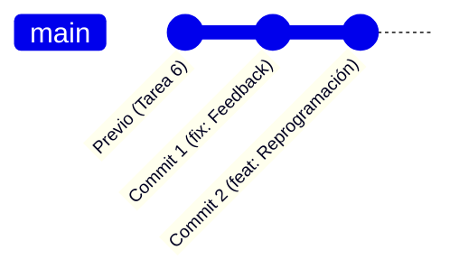
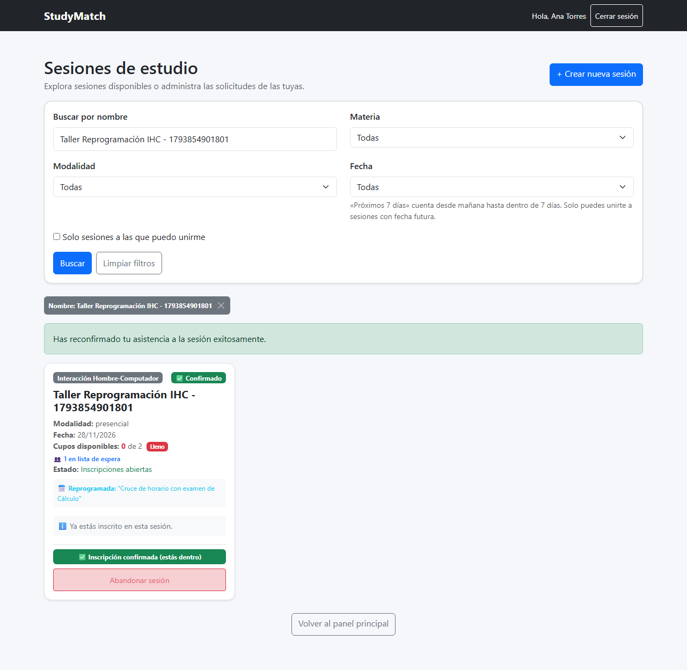
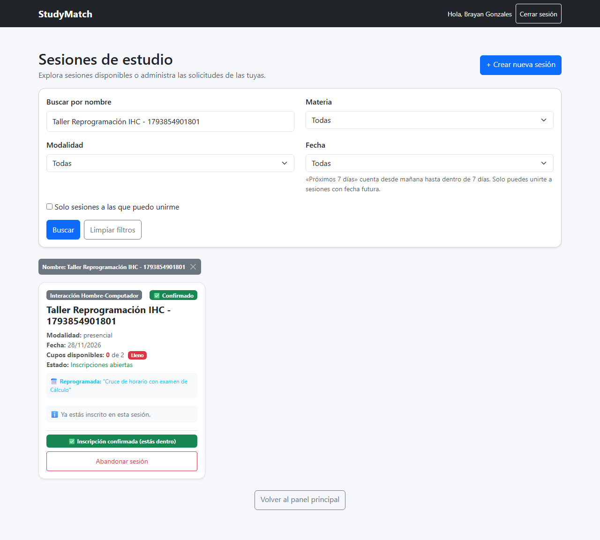

# Evidencias Tarea 7 - Usabilidad, Mejora por Feedback y Reprogramación con Reconfirmación

**Materia:** Interacción Hombre-Computador (IHC)  
**Estudiante:** Fernando Calani  
**Proyecto Asignado:** **StudyMatch** (Fork)  
**Repositorio Remoto (Fork):** [https://github.com/FernandojCg737/2do-Proyecto-Fork.git](https://github.com/FernandojCg737/2do-Proyecto-Fork.git)  

---

## 1. Enlace al Feedback Recibido (Clase 19)

El proyecto StudyMatch fue evaluado por el compañero **Franco Morón** durante la dinámica de Usabilidad y Evaluación de Producto (Clase 19):

* **Enlace al documento oficial de feedback:**  
  [Feedback recibido de Franco Morón](https://github.com/ary10220/ihc_segundo_proyecto/blob/main/clase-19-feedback-a-otro-proyecto/franco-moron/feedback.md)
* **Archivo de feedback redactado para el grupo asignado (Presupuesto Estudiantil):**  
  [feedback1.md](../clase-19-feedback-a-otro-proyecto/calani/feedback.md)

### Resumen de los Hallazgos del Evaluador:
1. **Contradicción visual en sesiones pasadas:** En la vista de sesiones, las sesiones cuya fecha ya venció mostraban el distintivo verde `"Inscripciones abiertas"`, a pesar de que el botón indicaba `"Sesión finalizada"` y no permitía interacción.
2. **Selector redundante de inscripciones al crear sesión:** En el formulario de nueva sesión existía un radio selector para `"Inscripciones: Abiertas / Cerradas"`. Al crear una sesión de estudio nueva, siempre nace abierta; colocar "cerradas" antes de invitar a nadie no tiene sentido operativo.
3. **Botón secundario / escape confuso:** En lugar de un botón estándar de `"Cancelar"`, el formulario presentaba un enlace textual `"Ver sesiones"`, lo que provocaba ambigüedad en la intención de navegación.
4. **Falta de asistencia en materias:** El campo `"Materia"` requería escritura manual completa, provocando posibles inconsistencias de texto y nombres duplicados.

---

## 2. Detalle de los Dos Cambios y Dos Commits (Diapositiva 14)

Tal como se estipuló en los requerimientos de la Clase 19 (Diapositivas 13 y 14), la entrega se estructura en **dos commits independientes y atómicos**:



### Commit 1: Mejora por Feedback (`fix`)

* **Mensaje del Commit:**  
  `fix: simplificar formulario de sesion, anadir datalist de materias y boton cancelar segun feedback`
* **Archivos modificados:**
  - `frontend/src/CreateSesionPage.jsx`
* **Problemas resueltos:**
  1. **Eliminación del selector redundante:** Se removió el radio group `checkdeinscripciones`. Las sesiones creadas nacen abiertas por defecto con estado booleano positivo.
  2. **Incorporación de `<datalist id="materias-sugeridas">`:** Permite al usuario seleccionar rápidamente asignaturas comunes (*Interacción Hombre-Computador, Programación Web, Base de Datos, Cálculo I, Inteligencia Artificial*, etc.) reduciendo errores tipográficos.
  3. **Acción explícita de escape "Cancelar":** Se reemplazó la ambigüedad con un botón de contorno secundario `Cancelar` (`.btn-outline-secondary`) visible para volver inmediatamente a la lista de sesiones.
  4. **Corrección de fechas en filtros:** En `frontend/src/SesionsPage.jsx`, los inputs de fecha `desde` y `hasta` cuentan con `min={today}` para evitar filtros anacrónicos.
  5. **Corrección del estado visual en sesiones pasadas:** En `frontend/src/SesionsPage.jsx`, si `sesion.es_pasada` es verdadero, la tarjeta muestra el badge gris neutral `Inscripciones cerradas (sesión pasada)` en lugar de afirmar falsamente que están abiertas.

---

### Commit 2: Funcionalidad Obligatoria de StudyMatch (`feat`)

* **Mensaje del Commit:**  
  `feat: reprogramar sesion con reconfirmacion y promocion de lista de espera`
* **Caso de Estudio:** **StudyMatch**
* **Funcionalidad Oficial:** *Reprogramar una sesión con reconfirmación*
* **Reglas de Negocio Implementadas:**
  1. **Reprogramación exclusiva del organizador:** Solo el creador/organizador de la sesión puede cambiar la fecha u horario de la misma e indicar obligatoriamente el `motivo` del cambio.
  2. **Transición a Reconfirmación con Reserva de Cupo:** Al reprogramarse, todos los participantes confirmados (`aceptada`) pasan al estado `pendiente_reconfirmacion`. Sus cupos se conservan temporalmente (la lista de espera no los invade).
  3. **Decisión del Participante:**
     - **Reconfirmar (`aceptar`):** El participante acepta la nueva fecha y regresa inmediatamente al estado `aceptada`.
     - **Retirarse (`salir_de_sesion`):** El participante rechaza la nueva fecha o se retira voluntariamente; su estado pasa a `cancelada`, liberando su cupo.
  4. **Promoción FIFO de Lista de Espera:** Al retirarse un participante (`aceptada` o `pendiente_reconfirmacion`), el **primer estudiante en lista de espera (`en_espera`) asciende automáticamente a confirmado (`aceptada`) una sola vez**.
  5. **Bloqueo de Reprogramaciones Consecutivas:** Mientras existan reconfirmaciones pendientes (`reconfirmaciones_pendientes_count > 0`), la aplicación bloquea cualquier intento de una nueva reprogramación.

---

## 3. Escenario Mínimo Demostrado y Evidencias Visuales

### Escenario Obligatorio (Diapositiva 13):
> *"Dos participantes: uno reconfirma y otro se retira; la primera persona en espera asciende una sola vez."*

### Evidencia 1: Reprogramación y Estado Pendiente de Reconfirmación
El organizador reprograma la sesión ingresando una nueva fecha y el motivo (*"Cruce de horario con examen de cálculo"*). Los participantes confirmados observan el aviso de reprogramación y sus opciones de acción:



* **Detalle visual:**
  - Badge destacado: `📅 Reprogramada: Cruce de horario con examen de cálculo`
  - Alerta para el participante: `⚠️ Requiere reconfirmación (Se cambió la fecha...)`
  - Acciones claras: Botón verde `✅ Aceptar nueva fecha` y botón rojo `🚪 Retirarme`.

---

### Evidencia 2: Resultado del Escenario Mínimo (Reconfirmación + Retiro + Ascenso FIFO)
Se ejecuta la secuencia completa del escenario:
1. **Participante 1 (Carlos):** Pulsa `Aceptar nueva fecha` $\rightarrow$ Su estado vuelve a **"Inscrito (Aceptada)"**.
2. **Participante 2 (Ana):** Pulsa `Retirarme` $\rightarrow$ Su inscripción se cancela y libera su plaza.
3. **Participante en Espera (Lucía):** Al liberarse el cupo, asciende automáticamente de `"Lista de espera (Lugar #1)"` a **"Inscrito (Aceptada)"** una sola vez.



---

## 4. Resultados de Pruebas Automatizadas

La solución está completamente blindada mediante pruebas unitarias en el backend y pruebas E2E en Playwright.

### 4.1 Pruebas Unitarias de Backend (`unittest` en Python)
Ubicación: `backend/tests/test_tarea7_reprogramacion.py`
* `test_reprogramar_sesion_cambia_fecha_y_estado_participantes`: Valida que los participantes pasen a `pendiente_reconfirmacion` y guarden el motivo.
* `test_bloqueo_reprogramar_mientras_hay_pendientes`: Comprueba el rechazo HTTP 400 si se intenta reprogramar con reconfirmaciones pendientes.
* `test_reconfirmar_participacion_vuelve_a_aceptada`: Verifica la aceptación del participante.
* `test_escenario_minimo_uno_reconfirma_otro_se_retira_y_espera_asciende`: Ejecuta el flujo exacto de la Diapositiva 13.
* `test_no_admite_fecha_pasada_en_reprogramacion`: Valida que no se permitan fechas anacrónicas.

```text
Ran 41 tests in 10.390s
OK
```

### 4.2 Pruebas End-to-End (`Playwright` en Chromium)
Ubicación: `tests/tarea7_e2e_reprogramacion.spec.ts`
* **Test 1:** Verificación de mejoras por feedback (sin selector redundante, con datalist y botón cancelar funcional).
* **Test 2:** Simulación con 4 navegadores concurrentes (Organizador + 2 Confirmados + 1 en Espera), validando la reconfirmación, el retiro y el ascenso automático en la interfaz real.

```text
Running 11 tests using 6 workers

  ✓  [chromium] › tests\tarea7_e2e_reprogramacion.spec.ts:28:3 › 1. Feedback: Formulario simplificado (1.8s)
  ✓  [chromium] › tests\tarea7_e2e_reprogramacion.spec.ts:63:3 › 2. Feature Tarea 7: Reprogramar -> Reconfirmar -> Retiro -> Ascenso (8.9s)
  ✓  Todas las suites anteriores (Clase 18 y Tarea 6) se mantienen pasando al 100%

  11 passed (14.9s)
```

---

## 5. Guía de Defensa Oral y Trazabilidad de Código

Si el docente solicita explicar el código en la defensa del proyecto:

| Componente / Archivo | Función / Línea Clave | Qué hace y por qué está ahí |
| :--- | :--- | :--- |
| `backend/app/modelos_db.py` | `SesionEstudio.motivo_reprogramacion` | Campo persistente en base de datos para almacenar el texto explicativo de la nueva fecha. |
| `backend/app/repositorio.py` | `reprogramar_sesion()` | Valida que la fecha sea futura, que no existan reconfirmaciones pendientes (`reconfirmaciones_pendientes_count == 0`) y pasa a los inscritos a `pendiente_reconfirmacion`. |
| `backend/app/repositorio.py` | `reconfirmar_participacion()` | Cambia la inscripción de `pendiente_reconfirmacion` de nuevo a `aceptada`. |
| `backend/app/repositorio.py` | `salir_de_sesion()` | Si el participante que se retira estaba en `aceptada` o `pendiente_reconfirmacion`, busca inmediatamente al primero en orden FIFO (`estado == 'en_espera'`) y lo promueve a `aceptada`. |
| `backend/app/routes.py` | `POST /sesiones/{id}/reprogramar` y `/reconfirmar` | Endpoints de la API REST que exponen las operaciones protegidas con JWT. |
| `frontend/src/CreateSesionPage.jsx` | `<datalist id="materias-sugeridas">` y `Cancelar` | Mejora de feedback: remueve controles superfluos y guía la selección del usuario. |
| `frontend/src/SesionsPage.jsx` | Modal de reprogramación y banner de reconfirmación | Renderiza dinámicamente la UI según si el usuario logueado es organizador o participante pendiente. |

