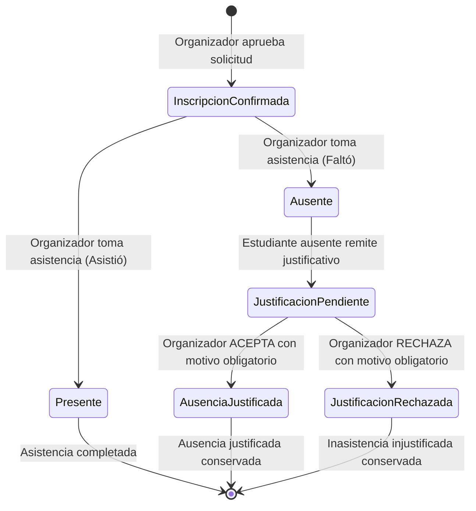
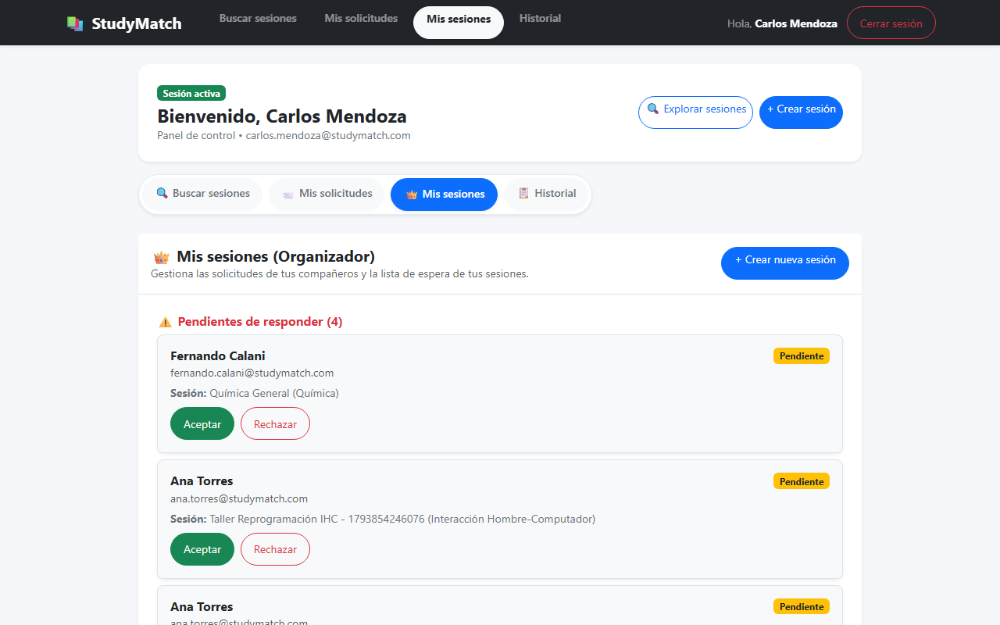
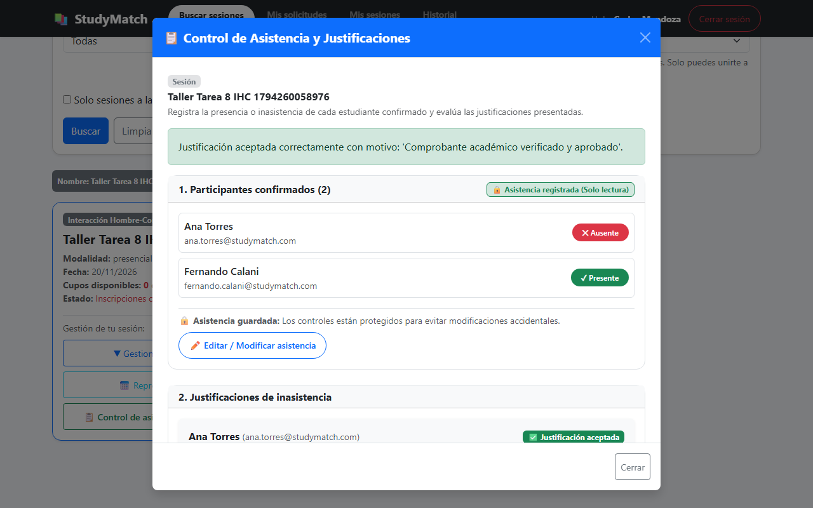
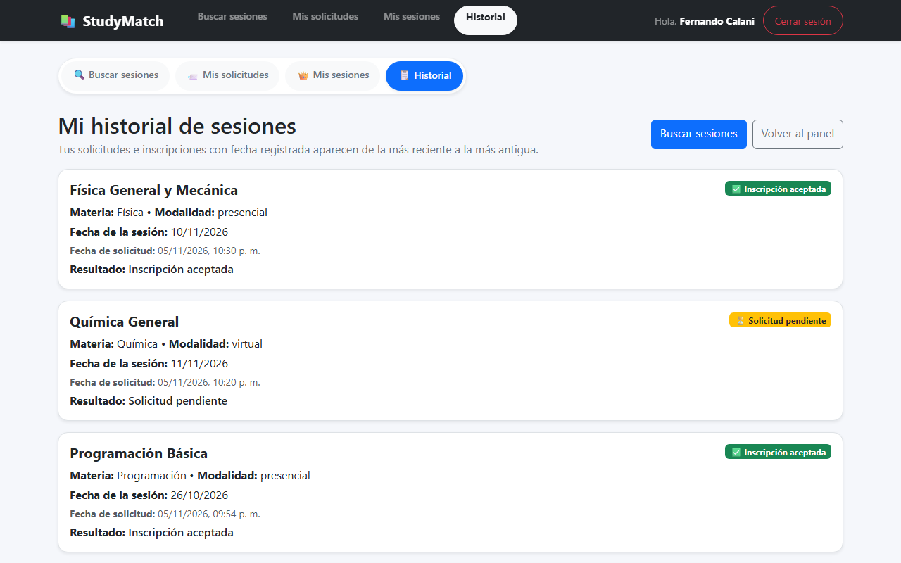
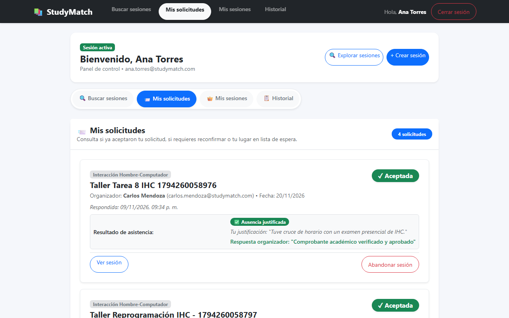
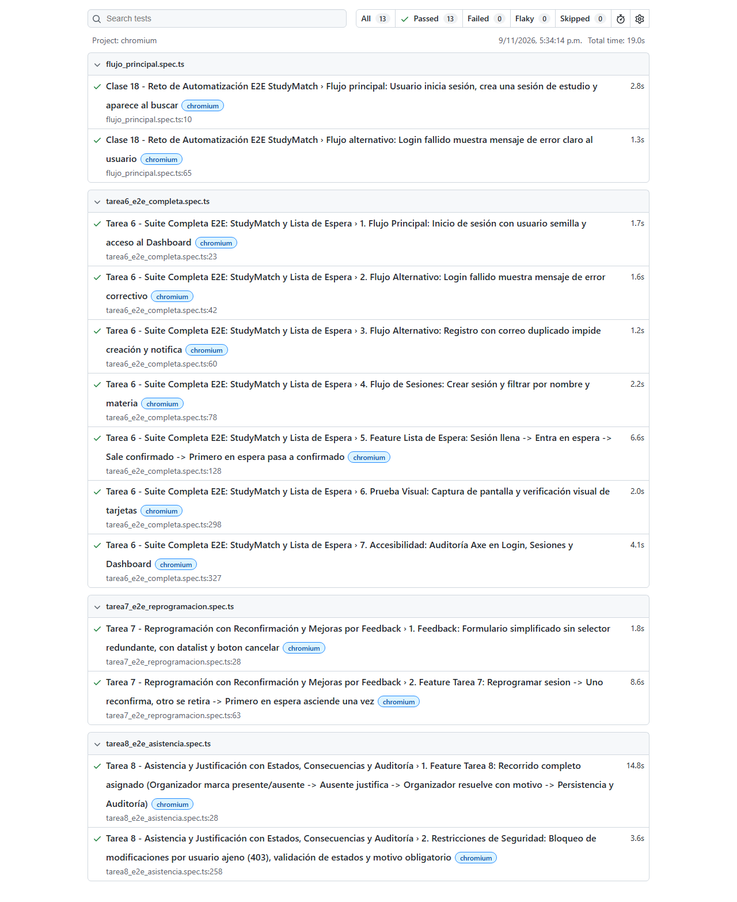

# Evidencias Tarea 8 - Incremento del Producto: Proceso con Estados, Consecuencias y Auditoría

**Materia:** Interacción Hombre-Computador (IHC)  
**Estudiante / Integrante:** Fernando Calani  
**Proyecto Asignado:** **StudyMatch** (Fork)  
**Funcionalidad Asignada:** **StudyMatch · Asistencia y justificación**  
**Repositorio Remoto (Fork):** [https://github.com/FernandojCg737/2do-Proyecto-Fork.git](https://github.com/FernandojCg737/2do-Proyecto-Fork.git)  
**Fecha de Entrega:** Martes 10/11/2026, 18:00  

---

## 1. Resumen de la Funcionalidad Asignada (StudyMatch · Asistencia y justificación)

Según las especificaciones de la **Tarea 8 (IHC Clase 20)**:
1. **Registro de asistencia:** Al terminar una sesión, el organizador registra *presentes* o *ausentes* entre sus participantes confirmados (`estado == 'aceptada'`). Cada participante consulta su resultado de forma clara y oportuna.
2. **Justificación:** Un estudiante ausente puede presentar formalmente una justificación; el organizador la evalúa y la *acepta* o *rechaza* indicando obligatoriamente un *motivo*.
3. **Conservación de la historia:** Se implementó una bitácora inmutable de auditoría (`HistorialCambioAsistencia`) que conserva cada cambio de estado, marcas temporales, actores involucrados y motivos/justificaciones.
4. **Restricción obligatoria:** Bloqueo estricto de modificaciones por un usuario ajeno (HTTP 403 Forbidden y deshabilitación en la interfaz de usuario).
5. **Persistencia:** Todos los estados y justificaciones persisten al recargar o volver a entrar a la aplicación.

---

## 2. Decisiones de Interacción Humano-Computador (IHC) y Arquitectura

### Diagrama de Estados y Consecuencias del Proceso:



#### Matriz de Transiciones de Estado y Consecuencias:
| Estado Inicial | Evento / Acción | Actor | Estado Resultante | Consecuencia y Persistencia |
| :--- | :--- | :--- | :--- | :--- |
| **Inscripción Confirmada** | Registro de Asistencia | Organizador | `Presente` | Estado persistido, asistencia exitosa completada. |
| **Inscripción Confirmada** | Registro de Asistencia | Organizador | `Ausente` | Habilita botón de envío de justificación para el estudiante. |
| **Ausente** | Envío de Justificación | Estudiante | `Justificación en revisión` (`pendiente`) | Se guarda la justificación y queda en espera de resolución. |
| **Justificación en revisión** | Resolución de Justificación (Aceptar) | Organizador | `Ausencia Justificada` (`aceptada`) | Justificación aprobada con motivo oficial visible persistente. |
| **Justificación en revisión** | Resolución de Justificación (Rechazar) | Organizador | `Justificación Rechazada` (`rechazada`) | Se conserva inasistencia con motivo explicativo del rechazo. |

### Heurísticas de Usabilidad Aplicadas (Jakob Nielsen):
1. **Visibilidad del estado del sistema y Trazabilidad Clara (Heurística #1):**
   - El estudiante consulta de inmediato su resultado mediante insignias coloreadas:
     - `✅ Presente en la sesión` (Verde).
     - `❌ Registrado como ausente` (Rojo).
     - `⏳ Justificación en revisión` (Amarillo advertencia).
     - `✅ Ausencia justificada` (Verde con motivo visible).
     - `❌ Justificación rechazada` (Rojo con motivo de rechazo visible).
   - **Bitácora de Auditoría Humanizada:** La tabla de cambios distingue claramente entre el **Estudiante** (la persona cuya asistencia se evalúa) y la **Acción realizada por (Actor)** (quién ejecutó el cambio: Organizador o Estudiante). Además, el campo detalle nombra explícitamente al alumno involucrado (ej. `"Asistencia de Ana Torres registrada como: PRESENTE"`).
   - **Zona Horaria Local Oficial (Bolivia UTC-4):** Las marcas temporales se formatean y presentan en la zona horaria de Bolivia (`America/La_Paz`) con formato estándar legible de 12 horas con indicador am/pm.
2. **Prevención de errores y validaciones defensivas (Heurística #5):**
   - Solo los participantes confirmados pueden ser marcados como presentes o ausentes (evita marcar a postulantes en espera o pendientes).
   - Solo los participantes marcados como ausentes tienen habilitado el botón de justificar.
   - El formulario de resolución exige de manera obligatoria que el organizador redacte un motivo (mínimo 3 caracteres), impidiendo respuestas vacías o ambiguas.
3. **Consistencia y estándares (Heurística #4):**
   - Integración natural dentro de los flujos preexistentes: pestaña `📨 Mis solicitudes` en el Dashboard, botón `📋 Control de asistencia` en `Mis sesiones` y visualización cronológica en `Mi historial`.
4. **Seguridad basada en roles (RBAC - Role-Based Access Control):**
   - Si un usuario ajeno o un estudiante intenta alterar la asistencia de la sesión o resolver justificaciones ajenas mediante API directa, el backend bloquea la petición con **HTTP 403 Forbidden**.

---

## 3. Archivos Afectados y Estructura del Código

### Backend (Python / FastAPI / SQLAlchemy):
* `backend/app/modelos_db.py`:
  - En `SesionEstudio`: Adición de columna `finalizada` para marcar la conclusión de la sesión.
  - En `Inscripcion`: Adición de columnas `asistencia`, `fecha_asistencia`, `justificacion`, `fecha_justificacion`, `estado_justificacion`, `motivo_respuesta_justificacion`, `fecha_respuesta_justificacion`.
  - Nueva entidad `HistorialCambioAsistencia`: Tabla relacional inmutable para la trazabilidad y auditoría de eventos.
* `backend/app/database.py`:
  - Migración automática en `inicializar_db()` para SQLite y PostgreSQL garantizando compatibilidad retrospectiva.
* `backend/app/models.py`:
  - Esquemas de validación Pydantic: `ItemAsistencia`, `RegistrarAsistenciaBatch`, `EnviarJustificacion`, `ResponderJustificacion`.
* `backend/app/repositorio.py`:
  - Funciones `finalizar_sesion`, `obtener_asistencia_sesion`, `registrar_asistencia_batch`, `presentar_justificacion`, `responder_justificacion`.
  - Actualización de `listar_mis_solicitudes`, `listar_solicitudes_organizador`, `filtrar_sesiones_con_estado` y `obtener_historial`.
* `backend/app/routes.py`:
  - Endpoints RESTful con control de autorización:
    - `POST /sesiones/{id}/finalizar`
    - `GET /sesiones/{id}/asistencia`
    - `POST /sesiones/{id}/asistencia`
    - `POST /sesiones/{id}/justificar`
    - `POST /sesiones/{id}/usuarios/{usuario_id}/responder-justificacion`
* `backend/tests/test_tarea8_asistencia.py`:
  - Suite de 8 pruebas unitarias automatizadas con cobertura de reglas de negocio y seguridad.

### Frontend (React / Vite / Bootstrap):
* `frontend/src/AsistenciaComponents.jsx` (Nuevo):
  - `InsigniaAsistencia`: Renderizado de badges y estado de justificación.
  - `ModalControlAsistencia`: Panel de control para el organizador con listado de participantes, toggles Presente/Ausente, evaluación de justificaciones y tabla de auditoría.
  - `ModalJustificarAusencia`: Modal accesible para el envío de justificaciones formales.
* `frontend/src/SesionsPage.jsx`:
  - Botón `📋 Control de asistencia y justificaciones` para el organizador en sus tarjetas de sesión.
  - Insignia de asistencia y botón de justificación para estudiantes confirmados.
* `frontend/src/Dashboard.jsx`:
  - En `Mis solicitudes`: Consulta de resultado de asistencia y modal de justificación.
  - En `Mis sesiones`: Acceso rápido al control de asistencia de las sesiones organizadas.
* `frontend/src/HistorialPage.jsx`:
  - Enlace al resultado de asistencia y justificaciones en el historial general.

### Pruebas E2E (Playwright):
* `tests/tarea8_e2e_asistencia.spec.ts`:
  - **Prueba 1 (Recorrido Completo):** Organizador marca presentes y ausentes $\rightarrow$ Estudiante ausente presenta justificación $\rightarrow$ Organizador acepta con motivo $\rightarrow$ Comprobación de persistencia y bitácora de auditoría.
  - **Prueba 2 (Restricciones y Seguridad):** Bloqueo a usuario ajeno (HTTP 403 y ausencia de controles en UI), impedimento de justificar a estudiantes presentes (HTTP 400) y motivo obligatorio al resolver (HTTP 400).

---

## 4. Evidencias Visuales: ANTES vs. DESPUÉS

### A. Vista del Organizador (Panel y Gestión de Sesión)

#### ANTES (Sin control de asistencia ni evaluación de justificaciones):

* *Observación:* La tarjeta de sesión solo permitía gestionar solicitudes iniciales o reprogramar la fecha; no existía ningún mecanismo para levantar lista de participantes ni gestionar inasistencias.

#### DESPUÉS (Con panel de asistencia, evaluación con motivo y bitácora de auditoría):

* *Observación:* El organizador cuenta con el modal interactivo de Control de Asistencia: marca presentes/ausentes, revisa las justificaciones presentadas con su texto, redacta el motivo obligatorio para aceptar/rechazar y visualiza el historial de auditoría de cada evento.

---

### B. Vista del Estudiante Participante (Mis solicitudes e Historial)

#### ANTES (Sin consulta de asistencia ni flujo de justificación):

* *Observación:* El alumno solo observaba el badge de solicitud aceptada, sin conocer si el organizador tomó asistencia ni posibilidad de justificar inasistencias por causas de fuerza mayor.

#### DESPUÉS (Con resultado de asistencia, justificación y motivo visible persistente):

* *Observación:* El estudiante visualiza de inmediato su resultado (`❌ Registrado como ausente`), activa el modal de justificación y, tras la resolución del organizador, observa de forma persistente: `✅ Ausencia justificada` junto con la explicación oficial del organizador (`"Comprobante académico verificado y aprobado"`).

---

## 5. Resultados de Pruebas Automatizadas

### A. Pruebas Unitarias del Backend (Python `unittest`)
Comando ejecutado:
```bash
python -m unittest tests/test_tarea8_asistencia.py
```
**Resultado:**
```text
........
----------------------------------------------------------------------
Ran 8 tests in 0.172s

OK
```
* **8 de 8 pruebas pasadas exitosamente (100% de éxito).**

---

### B. Pruebas E2E de la Funcionalidad (Playwright)
Comando ejecutado:
```bash
pnpm exec playwright test tests/tarea8_e2e_asistencia.spec.ts --project=chromium
```
**Resultado:**
```text
Running 2 tests using 2 workers

[1/2] [chromium] › tests\tarea8_e2e_asistencia.spec.ts:258:3 › 2. Restricciones de Seguridad (403, estados, motivo)
[2/2] [chromium] › tests\tarea8_e2e_asistencia.spec.ts:28:3 › 1. Feature Tarea 8: Recorrido completo asignado
Captura DESPUÉS Organizador guardada.
Captura DESPUÉS Estudiante guardada.

  2 passed (14.5s)
```
* **2 de 2 pruebas E2E pasadas exitosamente.**

---

### C. Verificación de Regresiones en la Suite Completa (Tareas 6, 7 y 8)
Comando ejecutado:
```bash
pnpm exec playwright test
```
**Resultado:**
```text
Running 13 tests using 6 workers

[1/13] [chromium] › tests\flujo_principal.spec.ts › Flujo alternativo: Login fallido
[2/13] [chromium] › tests\flujo_principal.spec.ts › Flujo principal: Crear sesión
[3/13] [chromium] › tests\tarea6_e2e_completa.spec.ts › 1. Flujo Principal Dashboard
[4/13] [chromium] › tests\tarea6_e2e_completa.spec.ts › 2. Login fallido
[5/13] [chromium] › tests\tarea6_e2e_completa.spec.ts › 3. Correo duplicado
[6/13] [chromium] › tests\tarea6_e2e_completa.spec.ts › 4. Crear sesión y filtrar
[7/13] [chromium] › tests\tarea6_e2e_completa.spec.ts › 5. Lista de espera FIFO
[8/13] [chromium] › tests\tarea6_e2e_completa.spec.ts › 6. Prueba Visual
[9/13] [chromium] › tests\tarea6_e2e_completa.spec.ts › 7. Accesibilidad Axe-core
[10/13] [chromium] › tests\tarea7_e2e_reprogramacion.spec.ts › 1. Feedback Clase 19
[11/13] [chromium] › tests\tarea7_e2e_reprogramacion.spec.ts › 2. Reprogramar con reconfirmación
[12/13] [chromium] › tests\tarea8_e2e_asistencia.spec.ts › 1. Recorrido completo Asistencia y Justificación
[13/13] [chromium] › tests\tarea8_e2e_asistencia.spec.ts › 2. Restricciones de Seguridad y Bloqueo 403

  13 passed (20.7s)
```
* **Total: 13 de 13 pruebas superadas sin ninguna regresión (0 fallos).**

#### Certificación Gráfica del Reporte de Pruebas Playwright (13 de 13 Pasadas):


---

## 6. Enlaces y Estructura de Commits para la Entrega

Siguiendo las pautas de commits atómicos y descriptivos:

1. **Commit 1 (Backend y Persistencia):**
   - **Mensaje:** `feat(tarea-8): backend y persistencia para asistencia, justificaciones y auditoria`
   - **Alcance:** Modelos SQLAlchemy (`modelos_db.py`), esquemas Pydantic (`models.py`), migración (`database.py`), repositorio con lógica de estados y permisos (`repositorio.py`), endpoints REST (`routes.py`) y tests unitarios (`test_tarea8_asistencia.py`).
2. **Commit 2 (Frontend React, Integración UI y E2E Playwright):**
   - **Mensaje:** `feat(tarea-8): componentes react, integracion ui y suite e2e playwright con evidencias`
   - **Alcance:** Componentes modulares (`AsistenciaComponents.jsx`), integración en vistas (`SesionsPage.jsx`, `Dashboard.jsx`, `HistorialPage.jsx`), suite completa Playwright (`tarea8_e2e_asistencia.spec.ts`), reporte de evidencias (`evidencias/tarea-8.md`) y capturas antes/después.

