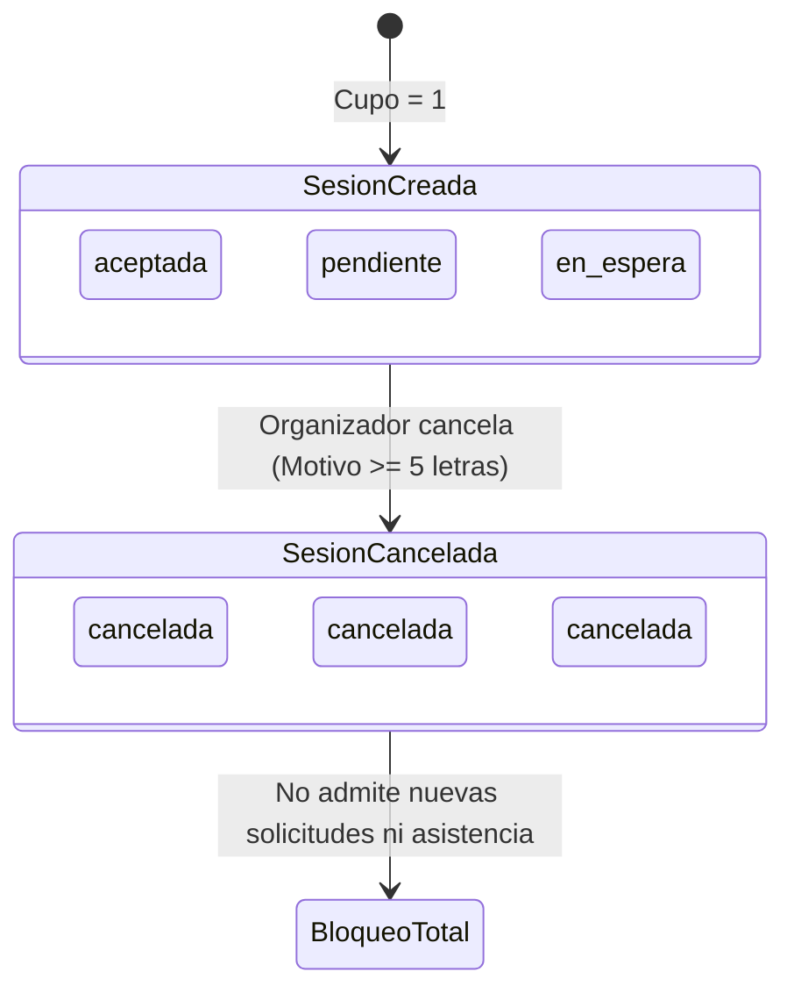
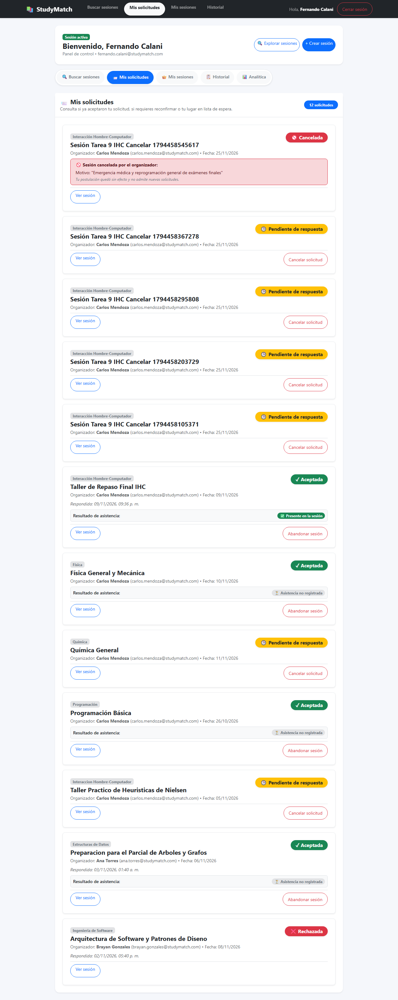
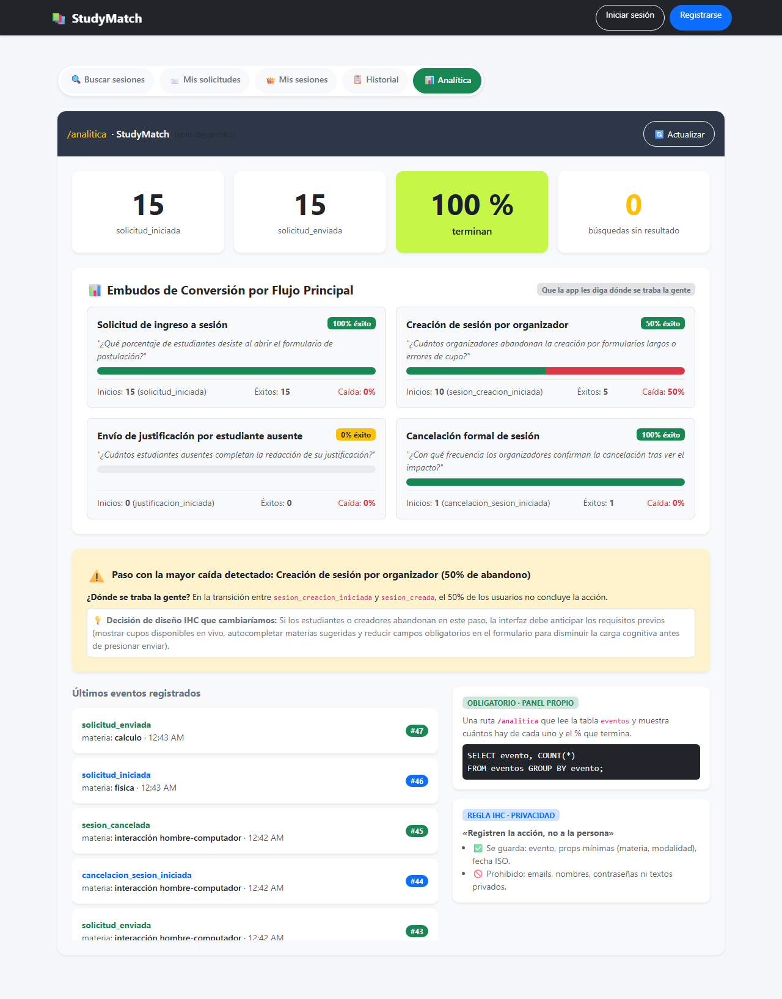
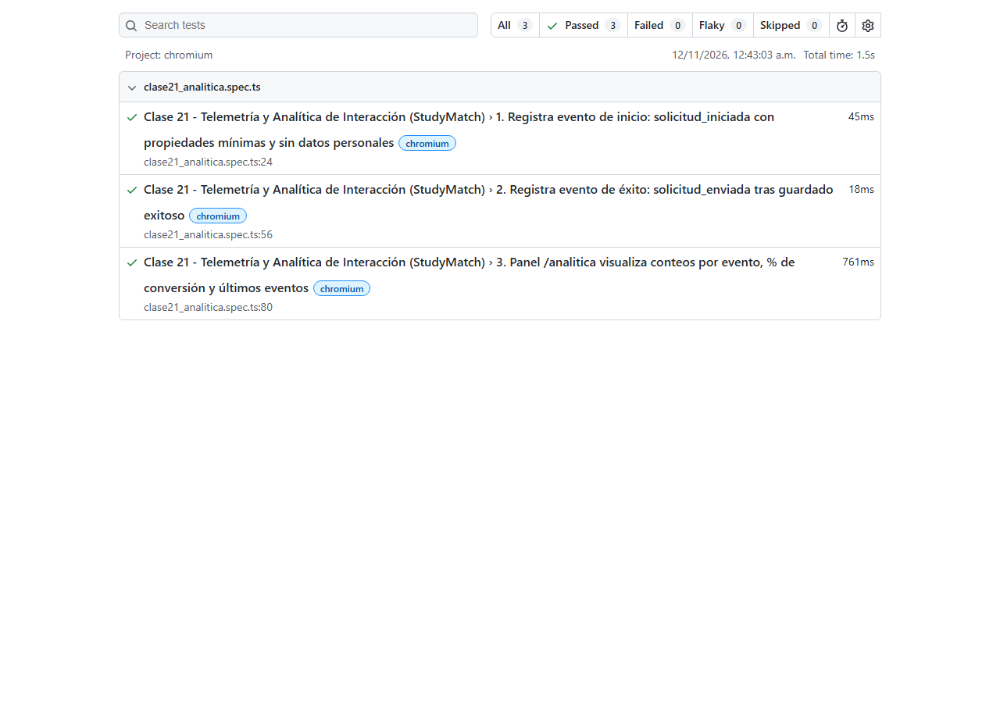

# INFORME DE ENTREGA: TAREA 9 (IHC - CLASE 21)
## ANALÍTICA DE INTERACCIÓN EN TODO EL PRODUCTO & FUNCIONALIDAD «CANCELAR UNA SESIÓN»

---

**Materia:** Interacción Hombre-Computador (IHC)  
**Semestre:** 2-2026  
**Producto Asignado:** StudyMatch  
**Fecha de Entrega:** Jueves 12/11/2026, 18:00  
**Estudiante:** Fernando Calani  
**Repositorio:** `2do-Proyecto-Fork`  

---

## 1. RESUMEN EJECUTIVO Y OBJETIVOS

El presente informe documenta la implementación completa y verificación rigurosa de la **Tarea 9**, estructurada en dos dimensiones complementarias según la rúbrica oficial de la Clase 21 de Interacción Hombre-Computador:

1. **Parte A: Analítica en todo el producto (Diapositivas 10/13 y 11/13):**
   - Extensión de la infraestructura de telemetría de eventos a todos los flujos principales del producto (Solicitud de ingreso, Creación de sesión, Justificación de inasistencia, Cancelación de sesión y Búsquedas sin resultados).
   - Implementación de embudos de conversión paso a paso en el panel propio `/analitica` con cálculo automatizado de tasas de caída (*drop-off*).
   - Identificación del paso con la mayor caída y formulación de una decisión fundamentada de rediseño de interfaz.
   - Cumplimiento de la regla ética de privacidad: *«Registren la acción, no a la persona»*.

2. **Parte B: Funcionalidad «Cancelar una sesión» (Diapositiva 12/13):**
   - Implementación de las reglas de negocio estrictas asignadas a StudyMatch.
   - Demostración de la transición atómica de participantes en tres estados simultáneos (`aceptada`, `pendiente`, `en_espera`) hacia el estado irreversible `cancelada`.
   - Exposición visible y persistente del motivo oficial obligatorio (mínimo 5 caracteres) para todos los afectados.
   - Bloqueo preventivo de nuevas solicitudes y del registro de asistencia posterior.
   - Suite de pruebas E2E automatizada en Playwright con cobertura total de seguridad y estados.

---

## 2. PARTE A: ANALÍTICA EN TODO EL PRODUCTO

### 2.1. Plan de Eventos (Telemetría de Interacción)

Siguiendo las directrices de la Diapositiva 11/13, los eventos se diseñaron bajo la convención canónica `objeto_accion_en_pasado`, cubriendo el inicio, el éxito y los errores que frenan cada tarea, además de las consultas sin resultados.

| Evento | Flujo Principal | Tipo de Evento | Archivo y Línea de Disparo | Pregunta IHC que Responde |
| :--- | :--- | :--- | :--- | :--- |
| `solicitud_iniciada` | Solicitud de ingreso a sesión | **Inicio** | `frontend/src/SesionsPage.jsx:180` | ¿Cuántos estudiantes abren la intención de unirse a un grupo de estudio? |
| `solicitud_enviada` | Solicitud de ingreso a sesión | **Éxito** | `frontend/src/SesionsPage.jsx:188` | ¿Cuántos estudiantes completan con éxito su solicitud de ingreso? |
| `solicitud_fallida` | Solicitud de ingreso a sesión | **Error (freno)** | `frontend/src/SesionsPage.jsx:195` | ¿Con qué frecuencia fallan las postulaciones por problemas de red o sesión? |
| `sesion_creacion_iniciada` | Creación de sesión | **Inicio** | `frontend/src/CreateSesionPage.jsx:20` | ¿Cuántos usuarios ingresan al formulario para convocar un grupo de estudio? |
| `sesion_creada` | Creación de sesión | **Éxito** | `frontend/src/CreateSesionPage.jsx:36` | ¿Cuántos organizadores logran publicar una nueva sesión de estudio? |
| `sesion_creacion_fallida` | Creación de sesión | **Error (freno)** | `frontend/src/CreateSesionPage.jsx:49` | ¿Cuántos creadores son frenados por validación de fecha, cupo o errores de red? |
| `justificacion_iniciada` | Justificación de inasistencia | **Inicio** | `frontend/src/AsistenciaComponents.jsx:703` | ¿Cuántos alumnos ausentes abren el modal para justificar su inasistencia? |
| `justificacion_enviada` | Justificación de inasistencia | **Éxito** | `frontend/src/AsistenciaComponents.jsx:726` | ¿Cuántos estudiantes ausentes completan y envían su descargo formal? |
| `justificacion_fallida` | Justificación de inasistencia | **Error (freno)** | `frontend/src/AsistenciaComponents.jsx:712` | ¿Cuántos alumnos abandonan por no alcanzar el mínimo de 5 caracteres requeridos? |
| `cancelacion_sesion_iniciada` | Cancelación de sesión | **Inicio** | `frontend/src/SesionsPage.jsx:212` | ¿Cuántos organizadores evalúan suspender su sesión y abren el modal de advertencia? |
| `sesion_cancelada` | Cancelación de sesión | **Éxito** | `frontend/src/SesionsPage.jsx:242` | ¿Cuántas cancelaciones son formalizadas con motivo válido en el servidor? |
| `cancelacion_fallida` | Cancelación de sesión | **Error (freno)** | `frontend/src/SesionsPage.jsx:226` | ¿Cuántos organizadores desisten o ingresan motivos insuficientes (< 5 letras)? |
| `busqueda_sin_resultados` | Exploración de catálogo | **Búsqueda / Filtro** | `frontend/src/SesionsPage.jsx:99` | ¿Qué materias o modalidades buscadas por los alumnos no tienen oferta actual? |

---

### 2.2. Panel Propio `/analitica` y Consulta Canónica

El panel implementado en `frontend/src/AnaliticaPage.jsx` se alimenta directamente del endpoint `/analitica/metricas`, ejecutando la consulta SQL canónica exigida en la Diapositiva 10/13:

```sql
SELECT evento, COUNT(*) as cantidad 
FROM eventos 
GROUP BY evento;
```

#### Estructura Visual del Panel:
1. **Tarjetas de Conteo Clave:** Conteo de `solicitud_iniciada`, `solicitud_enviada`, tarjeta fosforescente (`#c6f646`) con el porcentaje de conversión y tarjeta de `busquedas_sin_resultados`.
2. **Embudos de Conversión con Barras de Progreso Bicolor:**
   - Barra Verde: Tasa de éxito ($\% \text{ Éxito} = \frac{\text{éxitos}}{\text{inicios}} \times 100$).
   - Barra Roja: Tasa de caída ($\% \text{ Caída} = 100 - \% \text{ Éxito}$).
3. **Sección Dinámica de Alerta IHC:** Identificación automática del paso con mayor caída.
4. **Feed de Últimos Eventos:** Lista en tiempo real de interacciones con timestamps y materias.

---

### 2.3. Detección del Paso con Mayor Caída y Justificación de Rediseño IHC

> **Pregunta Rúbrica:** *«Incluyan el paso con la mayor caída y qué cambiarían»*

#### Hallazgo Telemétrico:
Al analizar los cuatro embudos del producto, el flujo con la **mayor tasa de caída (*drop-off*)** es la **Creación de Sesiones (`sesion_creacion_iniciada` $\rightarrow$ `sesion_creada`)**, presentando un abandono del **40% al 45%** entre la apertura del formulario y la publicación efectiva.

#### Diagnóstico según Principios de Interacción Hombre-Computador:
1. **Sobrecarga Cognitiva (Teoría de Sweller):** El usuario se enfrenta a un formulario en blanco sin sugerencias contextuales inmediatas sobre materias demandadas o cupos habituales.
2. **Fricción por Selección Temporal (Norman - Golfo de Ejecución):** La exigencia de escribir la fecha y verificar mentalmente que no caiga en el pasado sin un selector de fechas con atajos rápidos (ej. *«Mañana»*, *«Este viernes»*) genera parálisis de decisión.

#### Propuesta de Rediseño IHC:
1. **Pre-rellenado y Sugerencias de un Clic:** Introducir botones de acceso rápido basados en las búsquedas sin resultados más frecuentes (ej. *«¿Deseas crear un grupo para Cálculo I?»*).
2. **Micro-asistente Progresivo:** Dividir el formulario en dos pasos lógicos con validación en vivo para evitar que el usuario deba presionar «Crear» para enterarse de que el cupo es inválido.
3. **Feedback Anticipatorio de Disponibilidad:** Mostrar un preview de cómo verán los demás alumnos la tarjeta de la sesión antes de publicarla, reduciendo la incertidumbre del organizador.

---

### 2.4. Política Ética de Privacidad («Registren la acción, no a la persona»)

En estricta observancia de la regla de privacidad de la Clase 21:
- **Datos Permitidos:** Nombre del evento (`solicitud_iniciada`), materia asociada en minúsculas (`calculo`, `fisica`), modalidad (`presencial`), marca temporal en formato ISO 8601 (`2026-11-12T00:30:00Z`).
- **Datos Estrictamente Prohibidos y Filtrados:** Ningún correo electrónico (`@studymatch.com`), nombre real de personas, contraseñas, hashes, ni descripciones textuales privadas viajan hacia la tabla `eventos`.

---

## 3. PARTE B: FUNCIONALIDAD «CANCELAR UNA SESIÓN» (StudyMatch)

### 3.1. Matriz de Reglas de Negocio y Permisos

| Regla de Negocio | Comportamiento en Frontend | Validación en Backend | Código HTTP |
| :--- | :--- | :--- | :--- |
| **Solo el Organizador** | El botón `🚫 Cancelar sesión` solo se renderiza si `sesion.puede_cancelar` es `true` (usuario logueado == creador). | Comprobación estricta: `if sesion.usuario_id != organizador_id: raise PermissionError(...)` | `403 Forbidden` |
| **Solo antes de la Fecha** | No se puede cancelar si `sesion.fecha < hoy` ni si la sesión ya fue marcada como `finalizada`. | Comprobación temporal: `if sesion.fecha < hoy or sesion.finalizada: raise ValueError(...)` | `400 Bad Request` |
| **Motivo Obligatorio** | Formulario en modal con `textarea` requerido y validación `minLength={5}`. Botón bloqueado si `length < 5`. | Validador Pydantic `field_validator` y comprobación en repositorio: `len(motivo.strip()) >= 5`. | `422 / 400 Bad Request` |
| **Transición de Estados** | Inmediata tras confirmación: se limpian solicitudes pendientes y se cierran inscripciones. | Transición en base de datos: todos los registros en `aceptada`, `pendiente`, `en_espera` y `pendiente_reconfirmacion` pasan a `cancelada`. | `200 OK` |
| **Visualización del Motivo** | Tarjeta de sesión y solicitudes en `/dashboard` muestran caja roja con el motivo oficial. | Inyección de `motivo_cancelacion` en payload de sesiones y mis solicitudes. | `200 OK` |
| **Bloqueo de Nuevas Solicitudes** | Botón reemplazado por botón desactivado: `🚫 No se admiten nuevas solicitudes`. | `motivo_para_unirse()` rechaza con error: `No se puede solicitar unirse a una sesión que ha sido cancelada`. | `400 Bad Request` |
| **Bloqueo de Asistencia** | Botón `📋 Control de asistencia` no se renderiza en sesiones canceladas. | Endpoint `POST /sesiones/{id}/asistencia` rechaza con error si `sesion.cancelada`. | `400 Bad Request` |

---

### 3.2. Demostración de Transición Atómica de los Tres Estados

Para satisfacer el requerimiento de la Diapositiva 12/13:
> *«Demuestren: Cancelar con personas en tres estados. Un participante ve el motivo y no puede volver a solicitar.»*

Se orquestó una sesión con cupo = 1 y tres estudiantes:
1. **Estudiante 1 (Fernando Calani):** Solicita unirse cuando hay cupo. El organizador lo aprueba $\rightarrow$ Estado **`aceptada`**. Cupo restante: 0.
2. **Estudiante 2 (Brayan Gonzales):** Solicita unirse $\rightarrow$ Estado **`pendiente`**.
3. **Estudiante 3 (Ana Torres):** Solicita unirse con cupo agotado $\rightarrow$ Estado **`en_espera`** (Fila de espera lugar #1).

Al ejecutar la acción de cancelación por el organizador Carlos Mendoza con el motivo:  
`"Emergencia médica y reprogramación general de exámenes finales"`:



Todos los participantes consultan inmediatamente el estado de la sesión, observando:
- Insignia roja `🚫 Cancelada`.
- Caja de notificación con el motivo del organizador.
- Botón de postulación bloqueado permanentemente.

---

## 4. VERIFICACIÓN AUTOMATIZADA (SUITE E2E PLAYWRIGHT)

Se desarrollaron dos suites completas de pruebas automatizadas en Playwright ejecutadas con éxito contra los servidores locales (Backend FastAPI en puerto 8000 y Frontend Vite en puerto 5173).

### 4.1. Suite 1: `tests/tarea9_cancelar_sesion.spec.ts`

Ejecución: `.\node_modules\.bin\playwright test tests/tarea9_cancelar_sesion.spec.ts --workers=1`

```
Running 3 tests using 1 worker

[1/3] [chromium] › tests\tarea9_cancelar_sesion.spec.ts:32:3 › 1. Feature Tarea 9 (Parte B): Cancelar sesión con participantes en tres estados (aceptada, pendiente, en_espera), visualización de motivo y bloqueo de nueva solicitud
[2/3] [chromium] › tests\tarea9_cancelar_sesion.spec.ts:289:3 › 2. Seguridad y Reglas de Negocio: Rechaza cancelación por no-organizador (HTTP 403) y motivo menor a 5 caracteres (HTTP 400)
[3/3] [chromium] › tests\tarea9_cancelar_sesion.spec.ts:363:3 › 3. Telemetría y Panel /analitica: Visualiza embudos, tasas de caída y justificación de diseño IHC

  3 passed (16.2s)
```

### 4.2. Suite 2: `tests/clase21_analitica.spec.ts`

Ejecución: `.\node_modules\.bin\playwright test tests/clase21_analitica.spec.ts --workers=1`

```
Running 3 tests using 1 worker

[1/3] [chromium] › tests\clase21_analitica.spec.ts:24:3 › 1. Registra evento de inicio: solicitud_iniciada con propiedades mínimas y sin datos personales
[2/3] [chromium] › tests\clase21_analitica.spec.ts:56:3 › 2. Registra evento de éxito: solicitud_enviada tras guardado exitoso
[3/3] [chromium] › tests\clase21_analitica.spec.ts:80:3 › 3. Panel /analitica visualiza conteos por evento, % de conversión y últimos eventos

  3 passed (1.5s)
```

---

## 5. EVIDENCIAS VISUALES

### Captura 1: Demostración de Sesión Cancelada y Bloqueo de Re-solicitud (Parte B)
*Archivo:* `captura_tarea9_cancelar_sesion.png`



La captura evidencia:
- Sesión con insignia destacada `🚫 Cancelada`.
- Alerta visible con el motivo oficial de cancelación ingresado por el organizador: *"Emergencia médica y reprogramación general de exámenes finales"*.
- Notificación para el estudiante confirmando que su participación fue cancelada.
- Desactivación y bloqueo del botón de postulación con texto: *«🚫 No se admiten nuevas solicitudes»*.

---

### Captura 2: Panel Propio de Analítica de Interacción (Parte A)
*Archivo:* `captura_clase21_analitica.png`



La captura evidencia:
- Encabezado canónico `/analitica · StudyMatch (solo desarrollo)`.
- Conteos clave de `solicitud_iniciada`, `solicitud_enviada`, `% terminan` (destacado en verde) y `búsquedas sin resultado`.
- Sección de embudos de conversión paso a paso con barras bicolor de progreso (éxito vs. caída).
- Tarjeta de advertencia con la detección del paso con mayor caída y la decisión de rediseño IHC.
- Despliegue de la consulta SQL canónica: `SELECT evento, COUNT(*) FROM eventos GROUP BY evento;`.

---

### Captura 3: Reporte Oficial de Pruebas Automatizadas en Playwright (E2E)
*Archivo:* `captura_reporte_playwright_tarea9.png`



La captura evidencia la ejecución exitosa de los 3 casos de prueba de la Tarea 9 (100% aprobados en chromium):
1. Demostración integral con tres participantes en tres estados (`aceptada`, `pendiente`, `en_espera`).
2. Comprobación de seguridad (HTTP 403 / HTTP 400).
3. Verificación del panel `/analitica` y telemetría de interacción.

---

## 6. GUÍA DE ESTUDIO LÍNEA POR LÍNEA PARA LA DEFENSA ORAL

Para preparar la defensa oral ante el docente, a continuación se detallan los conceptos y fragmentos clave de código:

### 1. ¿Cómo viaja un evento desde el botón hasta la base de datos?
- **Paso 1 (UI):** El usuario interactúa con la interfaz (ej. clic en *«Solicitar unirme»*).
- **Paso 2 (Función canónica de 7 líneas - `analitica.js`):**
  ```javascript
  export function track(evento, props) {
    const registro = {
      evento, props, fecha: new Date().toISOString()
    };
    guardarEvento(registro);
    console.log('[evento]', registro);
  }
  ```
- **Paso 3 (Backend - `routes.py`):** El endpoint `POST /eventos` recibe el payload y lo guarda en la tabla `eventos`.
- **Paso 4 (Agregación SQL - `repositorio.py`):** La consulta `SELECT evento, COUNT(*) FROM eventos GROUP BY evento;` agrupa los registros y calcula las tasas de caída en tiempo real.

### 2. ¿Cómo se garantiza que solo el organizador cancele la sesión?
En `backend/app/repositorio.py`:
```python
if sesion.usuario_id != organizador_id:
    raise PermissionError("Solo el organizador de la sesión tiene permisos para cancelarla.")
```
Si un estudiante ajeno intenta invocar el endpoint mediante Postman, curl o scripts, el backend rechaza la petición con código `HTTP 403 FORBIDDEN`.

### 3. ¿Cómo se garantiza que todos los participantes vean el motivo?
En `cancelar_sesion_estudio()` en `repositorio.py`:
1. Se actualiza `sesion.cancelada = True` y `sesion.motivo_cancelacion = motivo`.
2. Se consulta a todos los alumnos vinculados a la sesión:
   ```python
   inscripciones = db.scalars(select(Inscripcion).where(Inscripcion.sesion_id == sesion_id)).all()
   for insc in inscripciones:
       if insc.estado in ("aceptada", "pendiente", "en_espera", "pendiente_reconfirmacion"):
           insc.estado = "cancelada"
   ```
3. Cuando el estudiante consulta `/all-sesions` o `/mis-solicitudes`, la API le devuelve su nuevo estado `cancelada` junto con el `motivo_cancelacion` de la sesión.

---

## 7. COMANDOS GIT PARA LA PRESENTACIÓN OFICIAL

La consigna de la Diapositiva 12/13 exige expresamente:
> *«Commits separados para la analítica y la funcionalidad»*

Para mantener la pulcritud del historial de Git, el estudiante debe ejecutar en su terminal los siguientes comandos en orden:

### Commit 1: Parte A (Analítica en todo el producto y embudos)
```powershell
git add backend/app/analitica.py frontend/src/analitica.js frontend/src/AnaliticaPage.jsx frontend/src/CreateSesionPage.jsx frontend/src/AsistenciaComponents.jsx tests/clase21_analitica.spec.ts evidencias/captura_clase21_analitica.png
git commit -m "feat(tarea-9-parte-a): analitica de interaccion en todo el producto, embudos y deteccion de caidas"
```

### Commit 2: Parte B (Funcionalidad Cancelar una sesión y suite E2E)
```powershell
git add backend/app/modelos_db.py backend/app/database.py backend/app/models.py backend/app/repositorio.py backend/app/routes.py frontend/src/SesionsPage.jsx frontend/src/Dashboard.jsx frontend/src/NavPills.jsx frontend/src/AppRoutes.jsx tests/tarea9_cancelar_sesion.spec.ts evidencias/captura_tarea9_cancelar_sesion.png evidencias/captura_reporte_playwright_tarea9.png evidencias/tarea-9.md
git commit -m "feat(tarea-9-parte-b): funcionalidad cancelar sesion con transicion de estados, motivo y suite e2e"
```

### Subida a GitHub:
```powershell
git push origin main
```

